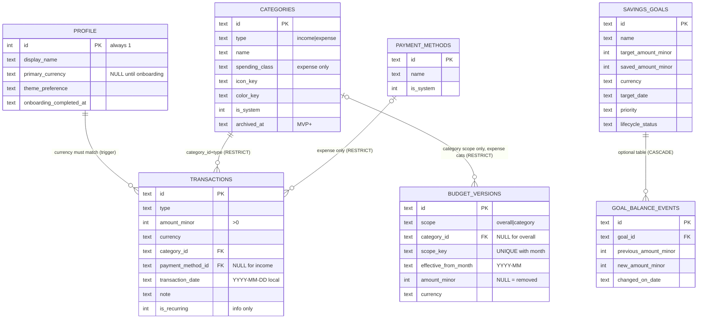

# D2 — Database Design

**Phase:** 2 — DESIGN · **Status:** Provisional ([OD-01](open-decisions.md#od-01)) · **Engine:** SQLite via `expo-sqlite` (SDK 57)
Related: [system-architecture](system-architecture.md) · [business-logic-design](business-logic-design.md) · ADRs [0002](../decisions/ADR-0002-money-integer-minor-units.md), [0003](../decisions/ADR-0003-local-calendar-dates.md), [0005](../decisions/ADR-0005-schema-rebaseline.md), [0006](../decisions/ADR-0006-budget-effective-month-versions.md), [0008](../decisions/ADR-0008-single-transactions-table.md), [0009](../decisions/ADR-0009-migrations-user-version.md)

> All SQL in this document is **illustrative design**, not a migration file. BUILD tasks produce the real migration from it.

---

## A. Entity identification

| Candidate entity | Decision | Reason |
|---|---|---|
| User profile | **Table `profile`** (singleton) | FR-001: name, primary currency, theme. One installation = one user (§36 excludes multi-user). |
| Application settings | **Merged into `profile`** | The MVP settings are currency and theme (FR-025.1). The warning thresholds are design constants, not user settings. A separate key-value table would add untyped storage for no benefit. |
| Categories | **Table `categories`** | FR-004 / FR-004.1. Seeded, read-only in the MVP. Columns for custom categories (MVP+) exist so that no rebuild is needed later. |
| Payment methods | **Table `payment_methods`** | FR-005. Seeded, read-only in the MVP. |
| Transactions | **Table `transactions`** (income + expense) | FR-002 / FR-003. Single table ([§E](#e-transaction-design)). |
| Budgets | **Table `budget_versions`** | FR-008.3 needs per-month history. Modeled as amounts that are effective from a month ([§F](#f-budget-design)). |
| Savings goals | **Table `savings_goals`** | FR-009. |
| Goal contributions | **Not in the MVP.** Optional `goal_balance_events` audit table, pending [OD-09](open-decisions.md#od-09) | PD-06: the saved amount is user-maintained, not the sum of contributions ([§G](#g-savings-goal-design)). |
| Recurring transactions | **Not in the MVP schema.** `recurring_rules` designed provisionally for MVP+ ([§H](#h-recurring-transactions-mvp-provisional)) | FR-020 is MVP+ and needs its own specification. In the MVP, recurring is an `is_recurring` flag (FR-002.1). |
| Recommendations | **No table** | FR-012.2: calculated each time they are displayed. FR-012.3: no dismissal or snooze in the MVP, so there is no state to persist ([ADR-0007](../decisions/ADR-0007-recommendations-computed-on-demand.md)). |
| Schema version | **`PRAGMA user_version`** (no table) | It is atomic with the migration's transaction. Replaces the broken `schema_migrations` approach ([§J](#j-database-migrations)). |

MVP table count: **6** (`profile`, `categories`, `payment_methods`, `transactions`, `budget_versions`, `savings_goals`), plus the optional `goal_balance_events`.

---

## B. Table definitions

### B.0 Conventions

| Concern | Rule |
|---|---|
| Naming | `snake_case` tables (plural, except the singleton `profile`) and columns. Money columns end in `_minor`. Local calendar dates end in `_date`. Months end in `_month`. UTC instants end in `_at`. |
| Primary keys | `TEXT`, generated client-side as `<prefix>_<time36>_<rand>` (e.g. `tx_m3k9…_8f2a1c9d4e`) by `shared/lib/ids.ts`. Seeded rows use stable readable IDs (`cat_food`, `pm_upi`). Client-side IDs double as idempotency keys (FR-026.4). |
| Money | `INTEGER` minor units + `currency TEXT` (ISO 4217, 3 uppercase letters) on every row that holds money ([§D](#d-monetary-data)). |
| Calendar dates | `TEXT 'YYYY-MM-DD'`, validated by `CHECK (col = date(col))`, which rejects malformed values and impossible dates such as 2026-02-30 ([ADR-0003](../decisions/ADR-0003-local-calendar-dates.md)). |
| Months | `TEXT 'YYYY-MM'`. |
| Timestamps | `TEXT` UTC ISO-8601 with milliseconds `YYYY-MM-DDTHH:MM:SS.SSSZ`, written by the repository from `Clock`. Default `strftime('%Y-%m-%dT%H:%M:%fZ','now')` uses the same format. Metadata only: **never** used to assign a transaction to a period. |
| Booleans | `INTEGER CHECK (x IN (0,1))`. |
| Foreign keys | `PRAGMA foreign_keys = ON` on every connection, set outside any transaction. Default action `RESTRICT`. |
| Strict typing | `CHECK (typeof(x) = 'integer')` on money columns, which stops SQLite type affinity from storing `12.5` or `'1250'`. (`STRICT` tables are not used, to keep table rebuilds simple and the schema portable to the test harness. The CHECKs give the same protection on the columns that matter.) |

### B.1 `profile`

| Field | Data type | Constraints | Description |
|---|---|---|---|
| `id` | INTEGER | PK, `CHECK (id = 1)` | Singleton row. |
| `display_name` | TEXT | NOT NULL, DEFAULT `''`, `CHECK (length(display_name) <= 40)` | Optional name for the greeting (FR-001). Empty means no name. |
| `primary_currency` | TEXT | NULL, `CHECK (primary_currency IS NULL OR primary_currency GLOB '[A-Z][A-Z][A-Z]')` | NULL until onboarding (FR-001.1). The domain checks it against the supported registry (INR only, FR-001.2). |
| `theme_preference` | TEXT | NOT NULL, DEFAULT `'system'`, `CHECK (… IN ('system','light','dark'))` | FR-001, FR-025.1. |
| `onboarding_completed_at` | TEXT | NULL | Set when onboarding finishes. Drives the first-launch redirect. |
| `created_at` / `updated_at` | TEXT | NOT NULL | Audit. |

The row is created by migration 1 with `primary_currency = NULL`. **Currency lock trigger** (FR-001.4, defense in depth behind the service check):

```sql
CREATE TRIGGER trg_profile_currency_lock
BEFORE UPDATE OF primary_currency ON profile
WHEN OLD.primary_currency IS NOT NULL
 AND NEW.primary_currency IS NOT OLD.primary_currency
 AND (EXISTS (SELECT 1 FROM transactions) OR EXISTS (SELECT 1 FROM budget_versions)
      OR EXISTS (SELECT 1 FROM savings_goals))
BEGIN SELECT RAISE(ABORT, 'CURRENCY_LOCKED'); END;
```

### B.2 `categories`

| Field | Data type | Constraints | Description |
|---|---|---|---|
| `id` | TEXT | PK | Stable seeded ID, e.g. `cat_food`. |
| `type` | TEXT | NOT NULL, `CHECK (type IN ('income','expense'))` | |
| `name` | TEXT | NOT NULL, `CHECK (length(name) BETWEEN 1 AND 30)` | Display name. |
| `spending_class` | TEXT | `CHECK (spending_class IN ('essential','discretionary','unclassified'))`. Table CHECK: expense ⇒ NOT NULL, income ⇒ NULL | FR-004.1. Fixed in the MVP. |
| `icon_key` | TEXT | NOT NULL | Key into the icon map ([ui-ux §A.9](ui-ux-design.md#a9-icon-conventions)). |
| `color_key` | TEXT | NOT NULL | Key into the theme's category palette (theme-aware; not a raw hex value). |
| `sort_order` | INTEGER | NOT NULL, DEFAULT 0 | Picker order. |
| `is_system` | INTEGER | NOT NULL DEFAULT 0, `CHECK (is_system IN (0,1))` | 1 = seeded. Cannot be renamed or archived (MVP+ rule). |
| `archived_at` | TEXT | NULL | MVP+ custom-category archive. Always NULL in the MVP. |
| `created_at` / `updated_at` | TEXT | NOT NULL | |
| — | — | `UNIQUE (id, type)` | Target of the composite foreign key from `transactions` (enforces that the category type matches the transaction type). |
| — | — | `UNIQUE INDEX ux_categories_type_name ON categories(type, name COLLATE NOCASE)` | No duplicate names within a type. ("Other" exists once per type.) |

### B.3 `payment_methods`

| Field | Data type | Constraints | Description |
|---|---|---|---|
| `id` | TEXT | PK | `pm_cash`, `pm_bank_transfer`, `pm_debit_card`, `pm_credit_card`, `pm_upi`, `pm_other` |
| `name` | TEXT | NOT NULL, `CHECK (length(name) BETWEEN 1 AND 30)`, UNIQUE COLLATE NOCASE | |
| `icon_key` | TEXT | NOT NULL | |
| `sort_order` | INTEGER | NOT NULL DEFAULT 0 | |
| `is_system` | INTEGER | NOT NULL DEFAULT 0 | |
| `archived_at` | TEXT | NULL | Reserved (MVP+). |
| `created_at` / `updated_at` | TEXT | NOT NULL | |

The "most recently used" preselection (FR-005.1) is **derived**, not stored: `SELECT payment_method_id FROM transactions WHERE type='expense' ORDER BY created_at DESC LIMIT 1`, falling back to `pm_cash`.

### B.4 `transactions`

| Field | Data type | Constraints | Description |
|---|---|---|---|
| `id` | TEXT | PK | Client ID (idempotency key). |
| `type` | TEXT | NOT NULL, `CHECK (type IN ('income','expense'))` | Direction (FR-003A.1). |
| `amount_minor` | INTEGER | NOT NULL, `CHECK (typeof(amount_minor)='integer' AND amount_minor BETWEEN 1 AND 9999999999)` | Always > 0 (FR-003A.1/.2). |
| `currency` | TEXT | NOT NULL, `CHECK (currency GLOB '[A-Z][A-Z][A-Z]')` | Must equal `profile.primary_currency` (trigger below). |
| `category_id` | TEXT | NOT NULL, FK `(category_id, type) → categories(id, type)` ON DELETE RESTRICT | Expense category / income source (FR-003.1). |
| `payment_method_id` | TEXT | NULL, FK → `payment_methods(id)` ON DELETE RESTRICT | Table CHECK: `(type='expense' AND payment_method_id IS NOT NULL) OR (type='income' AND payment_method_id IS NULL)` (FR-003.1, FR-003A.5). |
| `transaction_date` | TEXT | NOT NULL, `CHECK (transaction_date = date(transaction_date))` | Local calendar date (FR-019.1). The ≤ today rule (FR-019.5) is enforced in the domain, because "today" depends on the device time zone. |
| `note` | TEXT | NULL, `CHECK (note IS NULL OR length(note) BETWEEN 1 AND 200)` | Trimmed. An empty note is stored as NULL. SQLite `length()` counts characters, so the domain counts Unicode code points the same way (FR-003A.6). |
| `is_recurring` | INTEGER | NOT NULL DEFAULT 0, `CHECK (is_recurring IN (0,1))` | Information only (FR-002.1). |
| `created_at` / `updated_at` | TEXT | NOT NULL | Audit and list tie-break. |

```sql
CREATE TRIGGER trg_transactions_currency_ins
BEFORE INSERT ON transactions
WHEN NEW.currency IS NOT (SELECT primary_currency FROM profile WHERE id = 1)
BEGIN SELECT RAISE(ABORT, 'CURRENCY_MISMATCH'); END;
-- same trigger BEFORE UPDATE OF currency; equivalent triggers on budget_versions and savings_goals
```

### B.5 Deletion and archive policy

| Entity | Delete behavior | Why |
|---|---|---|
| Transactions | **Hard delete** after a confirmation that names the item (FR-026.1) | Soft delete would require `WHERE deleted_at IS NULL` in every aggregate. One missed clause silently corrupts totals. There is no undo requirement in the PRS. |
| Savings goals | **Hard delete** after confirmation. **Archive** is a separate, user-chosen lifecycle status (FR-009.2) | Archive keeps the goal visible in history. Delete removes it. |
| Budgets | "Remove budget" ends the series from the current month (a NULL-amount version) and keeps past months (FR-008.3). The past history is never deleted, except by Delete All Data | |
| Categories / payment methods | No delete in the MVP. MVP+ uses `archived_at`. RESTRICT foreign keys mean a referenced category can never be hard-deleted | M-35 |
| Everything | **Delete All Data** (FR-026.2), see [§J.7](#j7-delete-all-data) | |

### B.6 `budget_versions`

| Field | Data type | Constraints | Description |
|---|---|---|---|
| `id` | TEXT | PK | |
| `scope` | TEXT | NOT NULL, `CHECK (scope IN ('overall','category'))` | FR-008 types. |
| `category_id` | TEXT | NULL, FK → `categories(id)` ON DELETE RESTRICT | NULL for overall. A trigger enforces that the category is an expense category. |
| `scope_key` | TEXT | NOT NULL | `'overall'` or the category ID. Table CHECK: `(scope='overall' AND category_id IS NULL AND scope_key='overall') OR (scope='category' AND category_id IS NOT NULL AND scope_key=category_id)`. Exists because UNIQUE treats NULLs as distinct. |
| `effective_from_month` | TEXT | NOT NULL, `CHECK (effective_from_month GLOB '[0-9][0-9][0-9][0-9]-[0-1][0-9]' AND substr(effective_from_month,6,2) BETWEEN '01' AND '12')` | First month this version applies to. |
| `amount_minor` | INTEGER | NULL, `CHECK (amount_minor IS NULL OR (typeof(amount_minor)='integer' AND amount_minor BETWEEN 0 AND 9999999999))` | NULL = "no budget from this month" (removed). 0 is a valid zero budget (FR-008.6). |
| `currency` | TEXT | NOT NULL | Primary currency (trigger). |
| `created_at` / `updated_at` | TEXT | NOT NULL | |
| — | — | `UNIQUE (scope_key, effective_from_month)` | At most one version per scope per month, so overlapping budgets are impossible (FR-008.2). |

### B.7 `savings_goals`

| Field | Data type | Constraints | Description |
|---|---|---|---|
| `id` | TEXT | PK | |
| `name` | TEXT | NOT NULL, `CHECK (length(name) BETWEEN 1 AND 60)` | Trimmed (FR-003A.7). |
| `target_amount_minor` | INTEGER | NOT NULL, `CHECK (typeof(...)='integer' AND target_amount_minor BETWEEN 1 AND 9999999999)` | > 0 |
| `saved_amount_minor` | INTEGER | NOT NULL DEFAULT 0, `CHECK (typeof(...)='integer' AND saved_amount_minor BETWEEN 0 AND 9999999999)` | User-maintained (FR-009.1). Never negative. May exceed the target. |
| `currency` | TEXT | NOT NULL | Primary currency (trigger). |
| `target_date` | TEXT | NOT NULL, `CHECK (target_date = date(target_date))` | ≥ today **at creation** and whenever it is changed (domain rule). It may later fall into the past, which makes the goal Expired. |
| `priority` | TEXT | NOT NULL DEFAULT `'medium'`, `CHECK (priority IN ('high','medium','low'))` | Values pending [OD-06](open-decisions.md#od-06). |
| `lifecycle_status` | TEXT | NOT NULL DEFAULT `'active'`, `CHECK (lifecycle_status IN ('active','paused','archived'))` | User-set (FR-009.2). The **tracking state is never stored** (FR-011.2). |
| `created_at` / `updated_at` | TEXT | NOT NULL | `created_at` is the last tie-break in goal ordering. |

### B.8 `goal_balance_events` (optional, pending [OD-09](open-decisions.md#od-09))

| Field | Data type | Constraints | Description |
|---|---|---|---|
| `id` | TEXT | PK | |
| `goal_id` | TEXT | NOT NULL, FK → `savings_goals(id)` **ON DELETE CASCADE** | History goes with the goal. |
| `previous_amount_minor` | INTEGER | NULL (NULL for the initial balance), integer CHECK, 0…max | |
| `new_amount_minor` | INTEGER | NOT NULL, integer CHECK, 0…max | |
| `currency` | TEXT | NOT NULL | |
| `changed_on_date` | TEXT | NOT NULL, date CHECK | The local date of the change. |
| `created_at` | TEXT | NOT NULL | |

It is written in the same transaction as every change to `saved_amount_minor`, and it is not read by any MVP feature. Its purpose is to make the MVP+ "goal progress history" report (FR-018.2) possible, because that history cannot be reconstructed later.

---

## C. Entity relationships



| Relationship | Cardinality | Optional? | On delete of parent |
|---|---|---|---|
| categories → transactions | 1 : N | Required | RESTRICT (categories are never deleted in the MVP) |
| payment_methods → transactions | 1 : N | Required for expense, absent for income | RESTRICT |
| categories → budget_versions | 1 : N | Only for `scope='category'` | RESTRICT |
| savings_goals → goal_balance_events | 1 : N | — | CASCADE |
| profile → all money rows | logical (trigger) | — | Delete All Data clears the children first |

---

## D. Monetary data

([ADR-0002](../decisions/ADR-0002-money-integer-minor-units.md))

1. **Storage.** `INTEGER` minor units (paise for INR) + an explicit `currency` column on every money-bearing row. Never `REAL`. `CHECK (typeof(x)='integer')` rejects anything else at the database level.
2. **Currency registry** (`domain/money/currencies.ts`), the single source of precision:

   | Code | Minor digits | Symbol | Grouping | Max per record (minor) |
   |---|---|---|---|---|
   | INR | 2 | ₹ | Indian (3;2) | 9,999,999,999 |

   Every parse, format and limit check takes `minorDigits` from the registry, never from a hardcoded `100`. Adding a currency later is a code change plus a PRS change (FR-001.2). The schema does not need to change, because columns only CHECK the code's shape.
3. **No currency mixing.** `Money = { amountMinor: number; currency: CurrencyCode }`. Every binary operation asserts equal currency and throws `IntegrityError(CURRENCY_MISMATCH)`. Database triggers reject rows whose currency is not the primary currency. Aggregation queries additionally `GROUP BY currency`. More than one currency group in a result is an `IntegrityError` and is never summed (§33).
4. **Safe numeric limits.**

   | Quantity | Limit | Headroom |
   |---|---|---|
   | Single record (FR-003A.2) | 9,999,999,999 ≈ 1.0 × 10¹⁰ | < 2³⁴ |
   | JS exact integer (`Number.MAX_SAFE_INTEGER`) | 9,007,199,254,740,991 ≈ 9.0 × 10¹⁵ | |
   | SQLite INTEGER | 9.22 × 10¹⁸ (SUM raises "integer overflow" beyond this) | |
   | Sum of N max-value records that stays exact in JS | N ≤ 900,719 | 18× the NFR-001.1 volume (50,000) |
   | `amount × 100` or `× 1000` for percentages | can exceed 2⁵³ for large sums | **use BigInt** for all ratio math (`domain/money/ratio.ts`) |

   Every value read from SQL passes `assertSafeMinor(n)`: `Number.isSafeInteger(n)`, otherwise `IntegrityError(UNSAFE_INTEGER)`. Every JS addition or subtraction result is checked the same way. Calculations either produce exact results or fail explicitly (§34.2).
5. **Arithmetic.** Addition, subtraction and comparison are integer operations on `number`. Division appears only in (a) averages, (b) required monthly saving, and (c) percentages. Each has an **explicit rounding mode** defined in [business-logic §B](business-logic-design.md#b-financial-calculations): ceil for required saving (FR-010.2), floor for "up to" potential savings, half-away-from-zero for display. Exact intermediate values are kept as `Ratio { num: bigint; den: bigint }` (FR-007.4: only the display is rounded).
6. **Parsing input** (`parseAmount(text, currency)`): string-only, with no `Number()` on a decimal string and no float multiplication. Grammar: optional grouping commas, digits, optional `.` + up to `minorDigits` digits. More decimals are rejected (§34.1). Empty, signs, letters and multiple dots are rejected. Leading zeros are allowed. The integer is built as `BigInt(intPart) * 10n**d + BigInt(fracPadded)`, range-checked, then converted to `number`.
7. **Formatting** (`formatMoney(m, opts)`): a custom formatter for deterministic output across Hermes/Android/iOS, independent of device ICU data. INR → `₹1,00,000.00`, negative → `-₹1,250.50` (leading minus, §33.1). Options: `signDisplay: 'auto' | 'always'` (for income `+₹`). A compact variant (`₹1.2L`) is **not** used in the MVP, to avoid rounding ambiguity.

---

## E. Transaction design

**Decision: a single `transactions` table with a `type` discriminator** ([ADR-0008](../decisions/ADR-0008-single-transactions-table.md)).

| Criterion | One table + `type` | Separate `income` / `expenses` tables |
|---|---|---|
| Totals / savings (FR-007) | One indexed `SUM … GROUP BY type` | Two queries or a UNION |
| Unified history, search, filter by type (FR-002.2/.3) | Native | UNION ALL + duplicated pagination logic |
| Type-specific rules | CHECK for payment method; composite FK for category type | Natural |
| Editing type (expense ↔ income) | One UPDATE | Delete + insert across tables (identity changes) |
| Code duplication | One repository, one form | Two of everything |

The type-specific differences are small (payment method required vs absent; category type) and are fully enforced by table CHECKs and the composite foreign key. All required fields are covered: type, amount, category, date, payment method, note, and the recurring flag (`is_recurring`, information only in the MVP). Recurrence metadata for MVP+ goes in `recurring_rules` with a nullable link ([§H](#h-recurring-transactions-mvp-provisional)), not in more transaction columns.

---

## F. Budget design

([ADR-0006](../decisions/ADR-0006-budget-effective-month-versions.md))

**Model:** each budget is a *series* identified by `scope_key` (`overall` or a category ID). The series is stored as versions, each effective from a month until the next version.

**Resolution: the budget in effect for month M**

```sql
SELECT bv.*
FROM budget_versions bv
JOIN (SELECT scope_key, MAX(effective_from_month) AS m
      FROM budget_versions
      WHERE effective_from_month <= :month
      GROUP BY scope_key) cur
  ON cur.scope_key = bv.scope_key AND cur.m = bv.effective_from_month
WHERE bv.amount_minor IS NOT NULL;
```

**Operations** (C = the current month, `today`'s month):

| User action | Write (one transaction) | Effect |
|---|---|---|
| Create or change a budget (amount A) | `INSERT … ON CONFLICT(scope_key, effective_from_month) DO UPDATE SET amount_minor=A` at (K, C). Defensively delete versions of K with month > C. | Applies to C and every later month (FR-008.3). Past months keep their earlier versions. |
| Remove a budget | If an earlier version of K (month < C) exists: upsert (K, C) with `amount_minor = NULL`. Otherwise: delete the version at (K, C). | No budget from C onward. Past months unchanged (FR-008.3). |
| View a past month | Resolution query with `:month` = that month | Uses the amount that was in effect then. |

**Overlap rules:** `UNIQUE(scope_key, effective_from_month)` means there is at most one budget per scope per month. Overall and category budgets are independent; their sum may exceed the overall amount (FR-008.2). There is **no carry-over** (FR-008.5): every month is evaluated on its own spending.

**Budget period** is always a calendar month (FR-008.1). Creating budgets for past or future months is not offered ([OD-10](open-decisions.md#od-10)).

**Spending** (FR-008.4) is computed, never stored:

```sql
-- category budgets for a month (one query for all categories)
SELECT category_id, currency, SUM(amount_minor) AS spent
FROM transactions
WHERE type='expense' AND transaction_date BETWEEN :monthStart AND :monthEnd
GROUP BY category_id, currency;
-- the overall budget uses the same filter without GROUP BY category_id
```

---

## G. Savings goal design

| Requirement | Storage |
|---|---|
| Name, target amount, target date, priority | Columns on `savings_goals` |
| Current savings | `saved_amount_minor`, user-maintained (FR-009.1, PD-06) |
| Lifecycle status (Active / Paused / Archived) | `lifecycle_status` (FR-009.2) |
| Tracking state (Completed / Expired / On Track / At Risk / Behind) | **Not stored.** Calculated (FR-011.2) |
| Progress, remaining, required monthly saving, projection | **Not stored.** Calculated ([business-logic §B.9 – B.12](business-logic-design.md#b-financial-calculations)) |
| History | Optional `goal_balance_events` ([OD-09](open-decisions.md#od-09)) |

**Separate contribution records: not adopted for the MVP.** PD-06 chose a user-maintained balance. A contributions ledger would let the balance be derived as a sum. That is an alternative product model that would need a PRS change, and it raises the double-counting question below.

**Avoiding double-counting** (review R-13). The design keeps four quantities strictly separate, with distinct names in code and UI:

| Term (code name) | Definition | Source |
|---|---|---|
| **Savings** (`periodSavings`) | Income − expenses for a period (FR-007.0). May be negative. | transactions |
| **Expected monthly saving** (`expectedMonthlySaving`) | Average monthly savings over the recent complete months (FR-011.1). | transactions |
| **Goal saved amount** (`goal.savedAmount`) | Money the user says is set aside for this goal. | user input |
| **Required monthly saving** (`requiredMonthlySaving`) | What a goal needs per month (FR-010). | goal fields + today |

Rules:
- Moving money into a goal is **not** an expense and must not be recorded as a transaction. Updating a goal's saved amount never creates or changes a transaction, and transactions never change a goal's saved amount. The goal "Update saved amount" screen states this ([ui-ux §E](ui-ux-design.md#e-savings-goal-screens)).
- Goal progress uses `savedAmount` only. Goal *tracking* compares `requiredMonthlySaving` with `expectedMonthlySaving`. Neither adds `periodSavings` to `savedAmount`.
- Goals do not reduce dashboard "Savings", and there is no "unallocated savings" figure. Showing one would imply that period savings and goal balances are additive. **Product note:** if the user records a transfer to a savings account as an *expense* (category "Other"), dashboard savings will understate. Transfers are out of scope (§36). The privacy/help text advises not to record goal deposits as expenses ([OD-21](open-decisions.md#od-21) proposes PRS wording).

---

## H. Recurring transactions (MVP+, provisional)

> FR-020 is **MVP+** and requires its own specification, which must decide automatic vs user-confirmed generation. This section is a provisional data design so that the MVP schema does not block it. **Nothing here is built in the MVP.**

`recurring_rules` (proposed for a future migration):

| Field | Type | Constraints | Description |
|---|---|---|---|
| `id` | TEXT | PK | |
| `type`, `amount_minor`, `currency`, `category_id`, `payment_method_id`, `note` | as in `transactions` | same CHECKs and foreign keys | Template for each occurrence |
| `frequency` | TEXT | `IN ('weekly','monthly','yearly')` | |
| `interval_count` | INTEGER | ≥ 1, default 1 | "every 2 months" |
| `anchor_day` | INTEGER | 1–31 (monthly/yearly), 1–7 (weekly) | Intended day. Clamped per occurrence. |
| `start_date` | TEXT | date | First occurrence ≥ start. |
| `end_date` | TEXT | NULL, ≥ start_date | Inclusive. |
| `next_occurrence_date` | TEXT | date | The next date not yet generated. |
| `is_active` | INTEGER | 0/1 | |
| `created_at`, `updated_at` | TEXT | | |

`transactions` would gain `recurring_rule_id TEXT NULL REFERENCES recurring_rules(id) ON DELETE SET NULL` and `occurrence_date TEXT NULL`, with `UNIQUE (recurring_rule_id, occurrence_date)`. **That unique index is the duplicate-prevention guarantee**: re-running generation can never insert the same occurrence twice.

**Catch-up after the app was closed for several days.** On app start and on return to the foreground: for each active rule, in one transaction, generate every occurrence with `occurrence_date ≤ today` and `≤ end_date`, starting from `next_occurrence_date` and capped at 24 occurrences per rule per run. Each occurrence uses `INSERT … ON CONFLICT DO NOTHING`. Then advance `next_occurrence_date`. Occurrences are dated with their **scheduled** date, not the catch-up date, so monthly totals are correct. Monthly anchor 29–31 clamps to the last day of shorter months (31 Jan → 28/29 Feb → 31 Mar). The anchor is kept, so it does not drift. A backward device clock change cannot create duplicates (unique index) and cannot un-generate occurrences. If the FR-020 spec chooses user confirmation, the same loop creates *pending* occurrences in a separate table instead.

---

## I. Indexes and performance

Target: 50,000 transactions (NFR-001.1). The dashboard must be fully displayed in ≤ 1 s and a save must be visible in the list in ≤ 300 ms (NFR-001.2).

| Index | Columns | Serves query pattern |
|---|---|---|
| `ix_tx_list` | `transactions(transaction_date DESC, created_at DESC, id DESC)` | History list, keyset pagination: `WHERE (transaction_date, created_at, id) < (?,?,?) ORDER BY … LIMIT 50` |
| `ix_tx_date_type_amount` | `transactions(transaction_date, type, amount_minor)` | **Covering** index for period totals and monthly series: `SUM(amount_minor) … WHERE transaction_date BETWEEN ? AND ? GROUP BY type` and `GROUP BY substr(transaction_date,1,7), type` |
| `ix_tx_category_date_amount` | `transactions(category_id, transaction_date, amount_minor)` | Covering index for category totals per month (budgets, reports, anomaly history). Also serves the FK lookup. |
| `ix_tx_payment_method` | `transactions(payment_method_id)` | Payment-method filter; FK RESTRICT check |
| `ux_budget_scope_month` | `budget_versions(scope_key, effective_from_month)` UNIQUE | Resolution query |
| `ix_budget_category` | `budget_versions(category_id)` | FK RESTRICT check |
| `ix_goals_status_date` | `savings_goals(lifecycle_status, target_date)` | Active goals list |
| `ux_categories_type_name` | `categories(type, name COLLATE NOCASE)` | Uniqueness, picker |

There is no standalone `type` index (only two values, low selectivity; it is covered by the composite). Recommendation status needs no index because recommendations are not stored.

**Search** (FR-002.2): `(note LIKE :q ESCAPE '\' OR c.name LIKE :q ESCAPE '\')` with `%`, `_` and `\` escaped in user input. LIKE is case-insensitive for ASCII, which is sufficient for the English-only MVP (§33.1). It cannot use an index; scanning 50k rows with the join is expected to stay well under 100 ms (to be verified on the reference device, [OD-18](open-decisions.md#od-18)). FTS5 (available through the expo-sqlite `enableFTS`, on by default) is the documented escalation if measurement fails.

**Other performance rules:** aggregate in SQL, never load all rows into JS; the list renders through `FlatList` with pages of 50; the dashboard runs ≤ 6 queries, all index-backed; run `ANALYZE` after migrations (`PRAGMA optimize` on app background).

---

## J. Database migrations

([ADR-0009](../decisions/ADR-0009-migrations-user-version.md), [ADR-0005](../decisions/ADR-0005-schema-rebaseline.md))

### J.1 Versioning
- The schema version is `PRAGMA user_version`. Migrations are an ordered array `{ version: n, name, up: (tx) => Promise<void> }` in `src/data/db/migrations/`, one file per version (`0001_baseline.ts`, …).
- Each migration and its `PRAGMA user_version = n` run **in the same transaction**, so a crash leaves the database at n−1 or n, never in between.
- Applied migrations are **immutable**. Changes always add a new version. A CI test fails if the SQL of an existing migration file changes (snapshot hash).

### J.2 Startup sequence (DatabaseGate)

```mermaid
flowchart TD
    A[open financetracker.db] -->|fail| E1[DatabaseUnavailable: DB_OPEN_FAILED]
    A --> B[PRAGMA foreign_keys=ON; journal_mode=WAL; busy_timeout]
    B --> C{user_version v}
    C -->|v > LATEST| E2[DB_SCHEMA_NEWER — app downgrade; do not touch]
    C -->|v = 0 and legacy draft tables exist| L[Legacy handling — §J.6]
    C -->|v = LATEST| R[ready]
    C -->|0 ≤ v < LATEST| D{v > 0?}
    D -->|yes| BK[backupDatabaseAsync → financetracker.pre-v{v}.db]
    D -->|no, fresh| M
    BK --> M[for n in v+1..LATEST: BEGIN; up(n); PRAGMA user_version=n; COMMIT]
    M -->|any failure| RB[ROLLBACK → DB_MIGRATION_FAILED; database stays at last good version]
    M --> V[PRAGMA foreign_key_check → must be empty; quick_check = ok]
    V -->|fail| E3[DB_MIGRATION_FAILED]
    V --> R
```

### J.3 Forward-only migrations, data preservation
- Additive changes (`ADD COLUMN` with a default, new table, new index) go directly.
- Changes SQLite cannot ALTER (CHECK, FK, type) use the documented 12-step **table rebuild**: `PRAGMA foreign_keys=OFF` (outside the transaction) → BEGIN → `CREATE TABLE new_x` → `INSERT INTO new_x SELECT …` → `DROP x` → `ALTER TABLE new_x RENAME TO x` → recreate indexes and triggers → `PRAGMA foreign_key_check` → COMMIT → `foreign_keys=ON`. A row-count assertion (`old count = new count`) runs before DROP.
- No migration may DELETE user rows, except to correct invalid data, and that must be explicitly approved in its task (FR-026.5).

### J.4 Rollback and recovery
- Down migrations are not supported (SQLite DDL is not reliably reversible, and down migrations are rarely tested).
- **Failure during a migration:** the transaction rolls back, the database stays at the previous version, the app shows the FR-027.2 error screen, and nothing is deleted. A fixed app update can retry.
- **Pre-migration backup:** before upgrading an existing database (v > 0), `backupDatabaseAsync` copies it to `financetracker.pre-v{v}.db` in the same private directory. Only the most recent backup is kept. It is deleted after the next successful launch at the new version **and** by Delete All Data. It is excluded from OS backup like the main file ([security §2](security-privacy-design.md)). It is a local recovery aid for support and development; there is no in-app restore UI (FR-023 is deferred).
- **App downgrade** (`user_version > LATEST`): blocking error, no writes.

### J.5 Default data seeding
Seeded **inside migration 1** (and in any later migration that changes defaults), using `INSERT OR IGNORE` with stable IDs, so seeding is versioned, idempotent and testable.

| ID | Type | Name | Spending class | Icon key |
|---|---|---|---|---|
| `cat_food` | expense | Food (eating out) | discretionary | `food` |
| `cat_groceries` | expense | Groceries | essential | `groceries` |
| `cat_transport` | expense | Transport | essential | `transport` |
| `cat_rent` | expense | Rent | essential | `rent` |
| `cat_bills` | expense | Bills | essential | `bills` |
| `cat_shopping` | expense | Shopping | discretionary | `shopping` |
| `cat_entertainment` | expense | Entertainment | discretionary | `entertainment` |
| `cat_health` | expense | Health | essential | `health` |
| `cat_education` | expense | Education | essential | `education` |
| `cat_travel` | expense | Travel | discretionary | `travel` |
| `cat_emi` | expense | EMI | essential | `emi` |
| `cat_subscriptions` | expense | Subscriptions | discretionary | `subscriptions` |
| `cat_other_expense` | expense | Other | unclassified | `other` |
| `cat_salary` | income | Salary | — | `salary` |
| `cat_business` | income | Business | — | `business` |
| `cat_freelance` | income | Freelance | — | `freelance` |
| `cat_investment` | income | Investment | — | `investment` |
| `cat_rental` | income | Rental | — | `rental` |
| `cat_other_income` | income | Other | — | `other` |

Display name "Food (eating out)": FR-004.1 classifies Food as eating out/takeaway/delivery. The label makes that visible, so users put home groceries under Groceries (essential). This refines the category label, which FR-004 permits ("may be refined during DESIGN").

Payment methods: `pm_cash` (Cash), `pm_bank_transfer`, `pm_debit_card`, `pm_credit_card`, `pm_upi`, `pm_other`. This fixes the draft typo `cm_bank_transfer`.

Migration 1 also inserts the `profile` row (id 1, currency NULL, theme `system`).

### J.6 Transition from the draft schema
The draft schema (v1–v2 via `schema_migrations`) conflicts with this design, and its runner cannot initialize a fresh database. **Recommended:** re-baseline. The new migration 1 is the schema above; draft migrations are retired ([ADR-0005](../decisions/ADR-0005-schema-rebaseline.md)). This is conditional on the product owner confirming that no installation holds real user data ([OD-14](open-decisions.md#od-14)).

For safety, if a database has `user_version = 0` **and** contains a `schema_migrations` table:
- If the draft `transactions`, `budgets` and `savings_goals` tables are all empty, drop the draft tables and run the baseline.
- Otherwise, stop with `DB_MIGRATION_FAILED` (code `LEGACY_DATA_PRESENT`). Never drop data. A developer clears app data manually.

Alternative (if OD-14 is answered "real data exists"): ship a conversion migration that maps `amount_cents → amount_minor`, `date → transaction_date`, `cm_bank_transfer → pm_bank_transfer`, budget `period_start`'s month → one `budget_versions` row per budget (lossy for non-month periods; reported to the user), and goal `status` → `lifecycle_status='active'`.

### J.7 Delete All Data (FR-026.2)
One transaction: `DELETE FROM goal_balance_events; DELETE FROM transactions; DELETE FROM budget_versions; DELETE FROM savings_goals; UPDATE profile SET display_name='', primary_currency=NULL, theme_preference='system', onboarding_completed_at=NULL`. Seeded categories and payment methods stay; they are not user data. After commit: `VACUUM` (so deleted pages are not left in the file) → `PRAGMA wal_checkpoint(TRUNCATE)` → delete `*.pre-v*.db` backups and any export temp files → bump all revisions → navigate to onboarding.

### J.8 Migration testing
See [testing-strategy §2](testing-strategy.md#2-database-testing). In summary: every migration runs in Jest against `node:sqlite` (real SQLite, see [OD-19](open-decisions.md#od-19)). Tests cover a fresh install (0 → LATEST), an upgrade from each previous version with fixture data and preserved-value assertions, an idempotent re-run, a failure-injection rollback, `foreign_key_check` = empty, and the "applied migrations are immutable" hash check.
