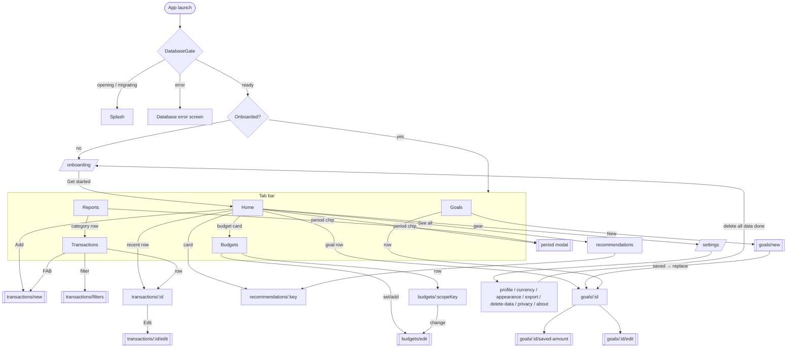

# D3 — Navigation Architecture

**Phase:** 2 — DESIGN · **Status:** Provisional ([OD-01](open-decisions.md#od-01)); the tab set needs product approval ([OD-02](open-decisions.md#od-02))
**Router:** Expo Router (file-based, typed routes enabled in `app.json`), routes in `src/app/`.
Related: [ui-ux-design](ui-ux-design.md) · [system-architecture](system-architecture.md) · [ADR-0010](../decisions/ADR-0010-navigation-five-tabs.md)

> The route tree below is a **proposed structure**. It is not an instruction to create files in this phase.

---

## A. Navigation structure

### A.1 Evaluation of the proposed tabs (Home, Transactions, Goals, Reports, Settings)

| Destination | Usage frequency | PRS weight | Tab? |
|---|---|---|---|
| Home (dashboard) | Every session | FR-006 primary screen | **Yes** |
| Transactions | Daily (add, review) | FR-002/003 core | **Yes** |
| Budgets | Several times a week; answers "how much can I safely spend?" (§2) | One of the six MVP product areas (§5) | **Yes (recommended)** |
| Goals | Weekly | MVP product area | **Yes** |
| Reports | Weekly/monthly | MVP product area | **Yes** |
| Recommendations | Through dashboard cards (max 3) | MVP product area, but surfaced on Home by FR-006.1 | No. Pushed route from Home |
| Settings | Rarely (onboarding, export, theme) | Supporting capability (§5) | No. Gear icon in the Home header |

**Where should Budgets go?**

| Option | Pros | Cons |
|---|---|---|
| (a) **Dedicated tab** (recommended) | One tap. Matches the six product areas. Budget status is the most actionable daily figure. | Pushes Settings out of the tab bar (5-tab maximum on Android Material navigation). |
| (b) Section within the dashboard only | Fewer tabs | Budget management (create, edit, past months, history) does not fit in a dashboard section. The dashboard becomes long. |
| (c) Separate route reached from the dashboard | Keeps the proposed tab set | Two taps for a core MVP area. Easy to miss. |

**Recommendation:** tabs **Home · Transactions · Budgets · Goals · Reports**. Settings opens from a gear button in the Home header (and is linked from empty states that need it). The dashboard also has a Budget section that links into the Budgets tab. Because the PRS does not define the navigation structure and AGENTS.md §4 forbids a new navigation structure without authorization, this needs approval ([OD-02](open-decisions.md#od-02)). The alternative (the user's original proposal with Settings as a tab and Budgets as a pushed route) is fully specified below as a fallback: only the tab list and the Budgets entry point change.

### A.2 Tab implementation
- Keep `NativeTabs` (`expo-router/unstable-native-tabs`, already used in `src/components/app-tabs.tsx`). It gives platform-native tab bars with built-in accessibility. Android supports up to 5 items.
- **Risk:** the API is marked *unstable*. If a breaking change appears, the fallback is the JS `Tabs` from `expo-router`. Only `(tabs)/_layout.tsx` is affected.
- The tab icons use `expo-symbols` (SF Symbols on iOS, Material Symbols on Android; already installed), replacing the PNG tab icons.
- `app-tabs.web.tsx` and web routes are not maintained in the MVP ([OD-13](open-decisions.md#od-13)).

---

## B. Route structure (proposed)

```text
src/app/
├── _layout.tsx                 Root Stack. Providers (theme), DatabaseGate (loading/error), ErrorBoundary,
│                               Stack.Protected guards: onboarding vs main app
├── +not-found.tsx              Unknown route → "Page not found" + Go home
├── onboarding.tsx              First launch: currency (required) + name (optional)     [guard: !onboarded]
├── (tabs)/                     [guard: onboarded]
│   ├── _layout.tsx             NativeTabs: index, transactions, budgets, goals, reports
│   ├── index.tsx               Home / Dashboard
│   ├── transactions.tsx        Transaction history (search, filters)
│   ├── budgets.tsx             Budget overview (month selector)
│   ├── goals.tsx               Goals overview
│   └── reports.tsx             Monthly / period report
├── transactions/
│   ├── new.tsx                 modal   ?type=expense|income
│   ├── filters.tsx             modal   filter sheet for the history list
│   └── [id]/
│       ├── index.tsx           push    transaction detail
│       └── edit.tsx            modal   edit transaction
├── budgets/
│   ├── edit.tsx                modal   ?scope=overall|category&categoryId=…  (create or change)
│   └── [scopeKey].tsx          push    budget detail ?month=YYYY-MM (default current)
├── goals/
│   ├── new.tsx                 modal
│   └── [id]/
│       ├── index.tsx           push    goal detail
│       ├── edit.tsx            modal   edit name/target/date/priority/status
│       └── saved-amount.tsx    modal   update saved amount
├── recommendations/
│   ├── index.tsx               push    full list + notices
│   └── [key].tsx               push    detail ("Why am I seeing this?")
├── period.tsx                  modal   period picker (current / previous / custom range)
└── settings/
    ├── index.tsx               push    settings list
    ├── profile.tsx             push    name
    ├── currency.tsx            push    primary currency (FR-001.4 lock)
    ├── appearance.tsx          push    theme
    ├── export.tsx              push    JSON export (FR-022)
    ├── delete-data.tsx         push    delete all data (FR-026.2)
    ├── privacy.tsx             push    privacy information (NFR-004.2)
    └── about.tsx               push    version, licences
```

Notes:
- Detail and form routes live in the **root Stack above the tabs**, so the tab bar is hidden while they are open. This gives one consistent back stack.
- Route params are validated in each route file with a Zod schema (`id` non-empty; `type` enum; `month` matches `YYYY-MM` and is not in the future). An invalid param renders the not-found state. It never crashes.
- The existing `src/app/{index,transactions,budgets,goals,explore}.tsx` are replaced. `explore.tsx` (starter) is removed in BUILD.
- Recommendation detail `[key]` is re-computed on open. If the key is no longer produced (the data changed), it shows "This suggestion no longer applies" and a link back.

---

## C. Navigation behavior

| Flow | Behavior |
|---|---|
| **First launch** | Root layout → DatabaseGate (splash while migrating). If `profile.onboarding_completed_at` is NULL, `Stack.Protected` routes to `/onboarding`: welcome text, currency select (INR is the only option and is preselected but must be confirmed, FR-001.1), optional name, a short privacy note ("Your data stays on this device", link to the privacy screen), and a **Get started** button. Saving sets the currency and `onboarding_completed_at`. The guard switches and the user lands on Home (`replace`, so back cannot return to onboarding). |
| **Dashboard navigation** | Home sections link to: Budgets tab (budget card), goal detail (goal row), Goals tab ("See all"), recommendation detail (card), Recommendations list ("See all"), transaction detail (recent row), Transactions tab ("See all"). Header: period chip → `/period` modal; gear → `/settings`. A primary **Add** button opens a choice (Expense / Income) → `/transactions/new?type=…`. |
| **Add transaction** | Modal (`presentation: 'modal'` on iOS, full-screen slide-up on Android). The type toggle at the top is pre-set from the param. On save, dismiss and show a toast ("Expense saved"), and the underlying screen refreshes through the revision store. Cancel or back with unsaved changes → "Discard this expense?" confirmation. Entry points: Home Add button, Transactions tab FAB, empty states. |
| **Transaction detail** | Pushed from any list. Shows all fields. Actions: Edit (→ `/transactions/[id]/edit` modal) and Delete (confirmation naming the item, FR-026.1, then back). |
| **Edit transaction** | Same form component as add, prefilled. Save → dismiss to detail (refreshed). Delete is not on the edit form (it is on detail), which avoids accidental deletes. |
| **Goal creation** | Goals tab "New goal" / Home empty state → `/goals/new` modal. After saving, `replace` with `/goals/[id]` so the user immediately sees required monthly saving. |
| **Goal detail** | Progress, required monthly saving, tracking state with explanation, projection, actions: Update saved amount (modal), Edit, Pause/Resume, Archive/Unarchive, Delete (confirmation). |
| **Budget management** | Budgets tab: month selector (current month by default; previous months are read-only, FR-008.3). "Set monthly budget" / "Add category budget" → `/budgets/edit` modal. Tapping a budget → `/budgets/[scopeKey]?month=` detail with spending, the transactions in that category for the month, Change amount, and Remove budget (confirmation: "Remove the Food budget from November onward? Past months keep their budgets."). |
| **Report filtering** | Reports tab header period chip → `/period` modal (current month · previous month · custom range with start/end date pickers, FR-019.4). The selected period is shared with Home (one `periodStore`, [state §2](state-management-design.md#2-state-ownership)). Category rows push to the Transactions tab pre-filtered by category + period. |
| **Settings navigation** | Standard pushed list → sub-pages. Destructive actions (delete all data) need a two-step confirmation (FR-026.2). After Delete All Data the stack resets to `/onboarding`. |


`[[…]]` = modal, `[…]` = pushed screen.

---

## D. Navigation states

| State | Rule |
|---|---|
| **App-level loading** | The splash screen stays visible (`SplashScreen.preventAutoHideAsync`) until DatabaseGate is `ready` or `error`. There is no blank flash. |
| **Screen loading** | Each data section renders a **skeleton** of its final layout (no full-screen spinner). Previously loaded data stays on screen during a revision refresh (stale-while-revalidate), with no flicker. Totals never show `₹0.00` as a placeholder (FR-006.2, FR-027.2). |
| **Empty states** | Per section, with an explanation and a primary action (FR-006.2). Catalog in [ui-ux §I](ui-ux-design.md#i-ui-states). |
| **Error states** | Section-level: an inline card "Couldn't load budgets. [Try again]". Route-level: Expo Router `ErrorBoundary` with Try again / Go home. App-level: the database error screen (FR-027.2) replaces the whole navigator, with no tabs, no totals and no automatic recreation. |
| **Modal behavior** | Forms are modals. A dirty form intercepts back, swipe-down and Cancel with a "Discard changes?" dialog (`usePreventRemove`). Save buttons are disabled while saving (FR-026.4). After a failed save the modal stays open with the values kept and a banner "…was not saved" (FR-027.1). |
| **Back navigation** | Android hardware/gesture back: modal → dismiss (with the dirty check). Pushed screen → pop. Non-Home tab root → Home tab. Home → exit app. iOS: swipe-back on pushed screens, swipe-down on modals. `predictiveBackGestureEnabled` stays false (current `app.json`) until it is tested. |
| **Stale targets** | Detail routes whose record was deleted (e.g. deleted from another screen) show "This item no longer exists" with Back. They never crash or show partial data. |
| **Deep links** | The `financetracker://` scheme exists (`app.json`). No deep-link feature is specified for the MVP, so **no routes are advertised**. Expo Router still resolves scheme URLs, so every route must tolerate direct entry: params validated, guards applied (a deep link before onboarding goes to onboarding), modals opened directly get a Close button that navigates to `/(tabs)` when there is no back stack. No route performs an action (save or delete) on load. Notification deep links come with FR-021 (MVP+). |
