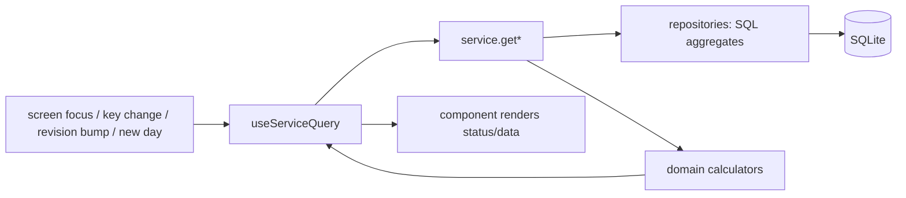

# D7 — State Management Design

**Phase:** 2 — DESIGN · **Status:** Provisional ([OD-01](open-decisions.md#od-01))
Related: [system-architecture](system-architecture.md) · [ADR-0004](../decisions/ADR-0004-sqlite-source-of-truth.md)

**Principle:** SQLite is the only owner of persistent financial records. Zustand holds session and UI state plus *signals* that data changed. It never holds copies of transactions, budgets or goals. This replaces the draft `appStore`, which loaded every transaction into memory.

---

## 1. Responsibilities

| Owner | Holds | Lifetime | Must not |
|---|---|---|---|
| **SQLite** | Profile, categories, payment methods, transactions, budget versions, goals | Permanent | — |
| **Repository layer** | Nothing (stateless functions) | — | Cache results |
| **Hooks (feature view-models)** | The **current query result** for the screen that mounted them (`{status, data, error}`), and action functions | While the screen is mounted | Share results globally; mutate data without a service |
| **Zustand** | Session (DB status, profile snapshot), data revisions, selected period, transaction filters, transient UI flags | App process (some fields persisted, see §2) | Hold financial record lists or totals |
| **React component state** | Ephemeral view state: open sheet, expanded section, search text before debounce | Component | Hold fetched data shared with other components |
| **Form state (React Hook Form)** | Field values, dirty/touched state, validation errors; Zod resolver from `domain` schemas | Form mount | Persist drafts (no draft persistence in the MVP) |

---

## 2. State ownership

| State | Store / location | Persisted? | Notes |
|---|---|---|---|
| DB status `connecting \| migrating \| ready \| error` + error code | `sessionStore` | No | Drives DatabaseGate. |
| Profile snapshot `{displayName, primaryCurrency, themePreference, onboarded}` | `sessionStore` | **SQLite** (`profile`); the store is a read-through cache refreshed after every profile write | Needed globally (formatting, theme, guards). Tiny, and changed only through `settingsService`, which writes SQLite first and then refreshes the snapshot. |
| **Selected currency** | Derived from the profile snapshot | SQLite | Every `Money` created in the UI takes the currency from here. Services re-read the currency from the DB inside the write transaction. |
| **Theme** | Profile snapshot `themePreference`; resolved scheme = preference or `useColorScheme()` | SQLite | |
| **Data revisions** `{transactions, budgets, goals, profile}` (integers) | `revisionStore` | No | Bumped by services after commit. Hooks list the topics they depend on. |
| **Selected date period** (Home + Reports) | `periodStore` `{kind:'month', month} \| {kind:'custom', start, end}` | No (resets to the current month on cold start, FR-006.1) | If stored as the "current month" and the month rolls over while the app is open, the store follows the new current month (it stores intent `current`, not a fixed month). |
| **Transaction filters + search** | `transactionFilterStore` `{period, type, categoryId, paymentMethodId, query}` | No | Separate from `periodStore`, so filtering history doesn't change the dashboard. Reports → category row sets these filters before navigating. |
| Budgets tab selected month | Route param / component state | No | |
| Toast queue | `uiStore` | No | |
| Form drafts | RHF | No | |

**Persistence choice:** none of the Zustand stores use `persist` middleware. Everything that must survive a restart lives in SQLite (NFR-002). This avoids a second storage system (AsyncStorage is not a dependency).

---

## 3. Data refresh strategy

### 3.1 Revision signals
```ts
// illustrative
type Topic = 'transactions' | 'budgets' | 'goals' | 'profile';
revisionStore.bump(topics: Topic[]): void;          // called only by services, after COMMIT
useRevision(topics: Topic[]): number;               // sum/tuple of selected revisions
```

### 3.2 Query hook pattern
```ts
// illustrative — shared/lib/useServiceQuery.ts
function useServiceQuery<T>(
  key: unknown[],                 // e.g. ['dashboardSummary', period, today]
  topics: Topic[],                // revisions that invalidate it
  load: () => Promise<Result<T, AppError>>,
): { status: 'loading' | 'ready' | 'error'; data?: T; error?: AppError; refetch(): void }
```
Behavior:
- It re-runs when `key` changes, when any listed revision changes, when the screen gains focus (`useFocusEffect`), and when the app returns to the foreground on a **new calendar day**.
- It keeps the previous `data` while re-loading (stale-while-revalidate), so there is no flicker and no ₹0 placeholder.
- It ignores results from superseded requests (a request counter), so a slow old query can't overwrite a newer result.
- It never throws; errors become `status:'error'`.

**Why not TanStack Query:** the needs are small (one local data source, no network retries, no cache persistence), and AGENTS.md §5 discourages dependencies for things that can reasonably be implemented internally. Revisit if the hook grows beyond about 100 lines.

### 3.3 Topic dependencies

| Hook / screen | Topics |
|---|---|
| Dashboard summary, Reports, Transactions list | `transactions` |
| Budget statuses (Home, Budgets) | `transactions`, `budgets` |
| Goals with tracking, Goal detail | `transactions`, `goals` |
| Recommendations | `transactions`, `budgets`, `goals` |
| Settings currency lock state | `transactions`, `budgets`, `goals`, `profile` |

### 3.4 Write path
```mermaid
sequenceDiagram
    participant UI as Form / Screen
    participant H as Hook action
    participant S as Service
    participant DB as SQLite
    participant R as revisionStore
    participant Q as Other mounted hooks
    UI->>H: save(values)
    H->>S: save(...)
    S->>DB: BEGIN; writes; COMMIT
    S->>R: bump(['transactions'])
    R-->>Q: revision changed
    Q->>DB: re-query aggregates
    Q-->>UI: new data rendered
    S-->>H: Ok
    H-->>UI: close modal, toast
```

### 3.5 Read path


---

## 4. State consistency rules

1. **Write first, then signal.** A revision is bumped only after a successful COMMIT. A failed write bumps nothing, so the UI cannot show unsaved data (FR-026.3).
2. **No optimistic updates** for financial records. Local writes are fast enough (NFR-001.2: 300 ms target) and optimism would risk showing data that was never stored.
3. **Single writer per entity.** Only the owning feature's service writes its tables. The settings Delete All Data service bumps every topic.
4. **Derived values are never stored** in Zustand. Totals, budget status, tracking states and recommendations are always recomputed from SQLite plus domain functions.
5. **The profile snapshot is updated from what was written**: after the profile write commits, the service reads the row back and sets the snapshot.
6. **"Today" is not stored.** Hooks call `clock.today()` at query time, and the day-change listener triggers a refresh.
7. **Concurrency:** the expo-sqlite connection serializes statements. Services use `withTransactionAsync` for multi-statement writes. No exclusive transactions in feature code: they open a separate connection where `PRAGMA foreign_keys` would be off, per the expo-sqlite docs.

---

## 5. Migration from the current draft

`src/store/appStore.ts` is retired in BUILD. Its responsibilities map as follows: `load()` → DatabaseGate + per-screen hooks; `transactions[]` → paginated query hook; `getTotals/getCategoryTotals` → SQL aggregates + domain; `setProfile` → `settingsService` + `sessionStore`.
