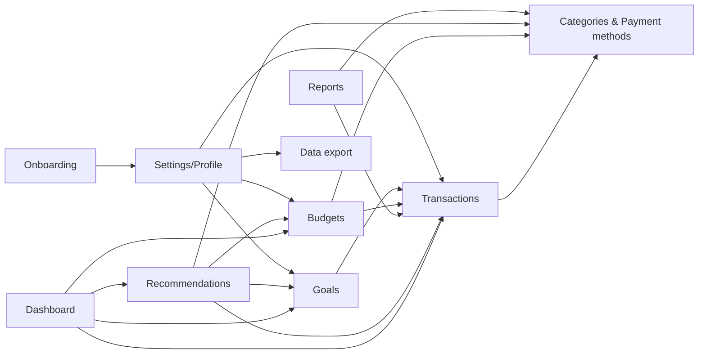
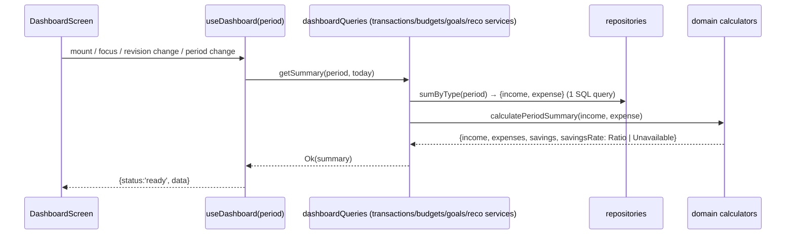

# D1 — System Architecture

**Phase:** 2 — DESIGN · **Status:** Provisional (PRS v1.1 final re-review pending — see [OD-01](open-decisions.md#od-01)) · **Date:** 2026-11-06
**Inputs:** `docs/requirements/product-requirements.md` v1.1, `docs/specs/prs-phase-1-review.md`, `AGENTS.md`, existing code at commit `e4b2a1e`.

Related: [database-design](database-design.md) · [business-logic-design](business-logic-design.md) · [recommendation-engine-design](recommendation-engine-design.md) · [state-management-design](state-management-design.md) · [navigation-design](navigation-design.md) · ADRs [0001](../decisions/ADR-0001-layered-feature-architecture.md), [0004](../decisions/ADR-0004-sqlite-source-of-truth.md)

---

## 0. Starting point (existing implementation)

The repository already contains draft code written before the PRS was reviewed. Under AGENTS.md §3 the approved spec and design outrank it. The design **replaces** the following, and implementation tasks (Phase 3) must migrate or retire them:

| Existing element | Problem against PRS v1.1 / this design | Design outcome |
|---|---|---|
| `src/db/database.ts` migration runner | Queries `schema_migrations` before any migration creates it, so a fresh database fails to initialize. `PRAGMA foreign_keys` is never enabled. | Replaced by the migration runner in [database-design §J](database-design.md#j-database-migrations). |
| `src/db/schema.ts` v1–v2 | Budgets use arbitrary `period_start/period_end` (violates FR-008.1/.3). There is no overall budget, because `category_id` is NOT NULL. Goal `status` mixes lifecycle state and tracking state (FR-009.2 / FR-011.2). Categories have no spending class (FR-004.1). There are no CHECK constraints. | New baseline schema ([ADR-0005](../decisions/ADR-0005-schema-rebaseline.md), pending [OD-14](open-decisions.md#od-14)). |
| `src/store/appStore.ts` | Holds every transaction in memory and computes totals in JS, which does not scale to 50,000 transactions (NFR-001.1). Hardcodes `'INR'`. `load()` is never called. | Retired. Replaced by the stores in [state-management-design](state-management-design.md). |
| `src/utils/money.ts` | `toCents` multiplies a float (`Math.round(num*100)`). It allows negative values. `savingsRate` returns a `Money` for a percentage. `formatMoney` does not use ₹ or Indian grouping (§33.1). | Replaced by `domain/money` ([business-logic §A.5](business-logic-design.md#a5-monetary-precision)). |
| `src/db/goals.ts` `computeGoalProgress` | `new Date('YYYY-MM-DD')` parses as UTC, which is a timezone bug. The month count excludes the current month (FR-010.1). Division produces fractional minor units. `onTrack` is a placeholder. | Replaced by `domain/goals`. |
| `src/db/budgets.ts` `computeBudgetStatus` | Pure logic lives in the repository file. The zero-budget rule (FR-008.6) is missing. | Moved to `domain/budgets`. |
| `src/db/seed.ts` | Payment method ID typo `cm_bank_transfer`. No spending class. | New seed ([database-design §J.5](database-design.md#j5-default-data-seeding)). |
| Screens `src/app/{index,transactions,budgets,goals}.tsx` | Read the store directly and do arithmetic in components. Only `index` and `explore` are reachable as tabs. | Rebuilt under the route structure in [navigation-design](navigation-design.md). |

Reusable as-is: theme hooks (`use-theme`, `use-color-scheme`), `ThemedText`/`ThemedView` (they will be extended with the new tokens), the jest-expo setup, and the TypeScript/ESLint configuration.

---

## A. Architecture pattern

### A.1 Evaluation

| Option | Fit | Verdict |
|---|---|---|
| **Feature-based modules** | The product has clear areas: transactions, budgets, goals, recommendations, reports, settings. Grouping each area's UI, hooks and services together makes changes local, which helps AI agents working one task at a time. | **Adopt** for presentation and orchestration code. |
| **Clean Architecture (full)** | Entities, use-case interactors, ports/adapters and DI containers would triple the file count for a single-user offline app with one data source. | **Adopt the principles only:** dependency direction inward, a pure domain core, and a data layer behind repository functions. Do **not** adopt DI containers, interface-per-class, or presenter objects. |
| **Separation of concerns** | AGENTS.md §8 and §10 require that UI does not query SQLite or contain financial logic. | **Mandatory.** |
| **Repository pattern** | Isolates SQL and row mapping, gives one place to enforce currency and integer checks on read, and lets tests run against a real in-memory SQLite. | **Adopt** as plain modules of async functions that take a `Db` handle. No class hierarchy. |
| **Service / use-case pattern** | Needed where an operation spans several repositories or rules (save transaction → validate → check currency lock → insert → bump revision; the recommendation engine needs four data sources). | **Adopt** one service module per feature. Services are thin functions, not one class per use case. |

### A.2 Decision

**A layered, feature-based architecture with a pure domain core** ([ADR-0001](../decisions/ADR-0001-layered-feature-architecture.md)).

The four rules:

1. **Domain is pure.** `src/domain/**` has no React, no expo-*, no SQLite, and no `Date.now()`. Time is passed in as `today: LocalDate`. Everything there is unit-testable in plain Jest (NFR-008).
2. **Dependencies point inward.** `app → features → (domain, data, shared)`, `data → domain`, and `domain → nothing` (except `date-fns` pure functions and `zod`).
3. **SQLite is the single source of truth** for persistent financial data. In-memory state is either a short-lived query result held by a hook, or UI/session state ([ADR-0004](../decisions/ADR-0004-sqlite-source-of-truth.md)).
4. **Features talk to each other only through their public `index.ts`.** Cross-feature calculations (dashboard, recommendations) go through domain functions and repositories, never through another feature's components or hooks.

---

## B. Application layers

```mermaid
flowchart TD
    subgraph P["Presentation layer — src/app (routes) + src/features/*/components + src/shared/ui"]
        R[Expo Router route files<br/>thin: params, layout, compose feature screens]
        C[Feature screens & components]
        UI[Design-system components]
    end
    subgraph F["Feature layer — src/features/*"]
        H[Hooks / view-models<br/>useDashboard, useTransactionForm…]
        S[Services / use cases<br/>transactionService.save…]
    end
    subgraph D["Domain layer — src/domain (pure)"]
        M[money, dates, validation schemas]
        CALC[calculators: totals, budgets, goals]
        ENG[recommendation engine]
        ERR[error types]
    end
    subgraph DATA["Data layer — src/data"]
        REPO[Repositories<br/>transactionsRepo, budgetsRepo…]
        MAP[Row mappers + read guards]
    end
    subgraph DB["Local database layer — src/data/db"]
        CONN[Connection, PRAGMAs]
        MIG[Migration runner + migrations]
        SQL[(SQLite file<br/>financetracker.db)]
    end
    subgraph SH["Shared/core — src/shared"]
        LOG[logger (redacting)]
        RES[Result type, ids, clock]
        STORE[Zustand UI/session stores]
    end

    R --> C --> H
    C --> UI
    H --> S
    H --> STORE
    S --> CALC
    S --> ENG
    S --> M
    S --> REPO
    REPO --> MAP --> M
    REPO --> CONN --> SQL
    MIG --> SQL
    S --> STORE
    H -.reads results.-> CALC
    F --> SH
    DATA --> SH
```

### B.1 Layer responsibilities

| # | Layer | Location | Responsibilities | Must not |
|---|---|---|---|---|
| 1 | **Presentation** | `src/app/**` (route files), `src/features/*/components`, `src/shared/ui` | Render state; collect input via React Hook Form; handle navigation; show loading, empty and error states; format values through `domain/format`. Route files stay under ~40 lines: they read params and render a feature screen component. | Query SQLite. Compute money. Call repositories. Hold financial records in global state. |
| 2 | **Feature** | `src/features/<feature>/{hooks,services}` | **Hooks** (view-models) fetch through services, subscribe to data revisions, and expose `{status, data, error, actions}`. **Services** (use cases) validate input with domain schemas, enforce business rules that need data (e.g. the currency lock), run repository calls inside a transaction, map errors, and bump data revisions. | Contain formulas (they call domain). Contain SQL. |
| 3 | **Domain / business logic** | `src/domain/**` | Types (`Money`, `LocalDate`, `MonthKey`, `Transaction`…), Zod schemas, calculators (FR-007 – FR-011), the budget status rules, the recommendation engine (FR-012 – FR-017), formatting, and error classes. Deterministic. Total functions that return discriminated unions such as `{kind:'unavailable', reason}`. | Perform I/O. Read the clock. Throw for expected business outcomes (use return values). |
| 4 | **Data / repository** | `src/data/repositories/*` | Parameterized SQL, row ↔ domain mapping, read guards (integer, safe range, known currency), aggregations in SQL (`SUM … GROUP BY`), keyset pagination. Throws `PersistenceError` with an operation name and the SQLite error code only. | Contain business rules beyond integrity. Log row contents. |
| 5 | **Local database** | `src/data/db/*` | Open the connection; set PRAGMAs (`foreign_keys=ON`, `journal_mode=WAL`); run migrations under `PRAGMA user_version`; make the pre-migration backup; seed defaults; `deleteAllData`. | Recreate or delete the database automatically on failure (FR-027.2). |
| 6 | **Shared / core** | `src/shared/{lib,ui,store}` | `Result<T,E>`, ID generator, `Clock` (the only place `new Date()` is read), redacting logger, Zustand stores for session/UI state, design-system components, theme tokens. | Depend on features. |

### B.2 Proposed source tree

This is a target structure. Implementation tasks create it incrementally.

```text
src/
  app/                         # Expo Router routes only (see navigation-design.md)
  features/
    onboarding/   { components/, hooks/, services/, index.ts }
    dashboard/    { components/, hooks/, index.ts }            # no own service; composes others
    transactions/ { components/, hooks/, services/, index.ts } # income + expense
    budgets/      { components/, hooks/, services/, index.ts }
    goals/        { components/, hooks/, services/, index.ts }
    recommendations/ { components/, hooks/, services/, index.ts }
    reports/      { components/, hooks/, services/, index.ts }
    settings/     { components/, hooks/, services/, index.ts } # profile, theme, currency, privacy, about
    data-export/  { components/, hooks/, services/, index.ts }
  domain/
    money/        # Money, currency registry, parse, arithmetic, format
    dates/        # LocalDate, MonthKey, Period, month math
    categories/   # spending class, category types
    transactions/ # types, zod schemas, totals calculators
    budgets/      # budget resolution, status, utilization
    goals/        # progress, required saving, expected saving, tracking state, projection
    recommendations/ # engine, rules/, ranking
    reports/      # category distribution
    errors/       # AppError hierarchy + codes
    format/       # percentage & money display rules
  data/
    db/           # connection.ts, migrations/, migrate.ts, seed.ts, backup.ts
    repositories/ # profileRepo, categoriesRepo, paymentMethodsRepo, transactionsRepo, budgetsRepo, goalsRepo, exportRepo
  shared/
    lib/          # result.ts, ids.ts, clock.ts, logger.ts
    ui/           # design-system components (ui-ux-design.md §J)
    store/        # sessionStore, revisionStore, periodStore, transactionFilterStore
    theme/        # tokens
```

Import rules (enforced by ESLint `no-restricted-imports` in a BUILD task):

| From \ may import | app | features | domain | data | shared |
|---|---|---|---|---|---|
| app | ✓ | ✓ (index only) | types only | ✗ | ✓ |
| features | ✗ | own + other features' `index.ts` | ✓ | ✓ (from services only) | ✓ |
| domain | ✗ | ✗ | ✓ | ✗ | `shared/lib/result` only |
| data | ✗ | ✗ | ✓ | ✓ | `shared/lib` |
| shared | ✗ | ✗ | ✓ (ui may use `domain/format`) | ✗ | ✓ |

### B.3 How information flows

- **Reads:** screen → hook → service `get*` → repositories (SQL aggregates) → domain calculators → hook state → screen. The hook re-runs when a relevant **data revision** changes ([state-management §3](state-management-design.md#3-data-refresh-strategy)) or the screen regains focus.
- **Writes:** form (RHF + Zod resolver) → hook action → service `save*` → domain validation → `withTransaction` repository writes → commit → `revisionStore.bump(topics)` → subscribed hooks re-query.

---

## C. Feature modules

| Module | Owns (PRS) | Owns data | Depends on |
|---|---|---|---|
| **Onboarding** | FR-001.1 (currency before data), first-run flow | writes `profile` | settings service (profile), domain/money (currency registry) |
| **Dashboard** | FR-006, FR-007 display | none | transactions (totals service), budgets, goals, recommendations: their services via `index.ts`; period store |
| **Transactions** | FR-002, FR-003, FR-003A, FR-005, FR-019 filters, FR-026.1 | `transactions` | categories (read), payment methods (read), profile (currency) |
| **Income / Expenses** | FR-003 / FR-002 | — | **Not separate modules.** They are modes (`type`) of Transactions, which share the form, list, repository and validation. They differ only in the field rules (payment method) and category type. See [database-design §E](database-design.md#e-transaction-design). |
| **Categories** | FR-004, FR-004.1 | `categories`, `payment_methods` (read-only in MVP) | — |
| | | | Categories have no screens in the MVP (custom categories are MVP+), so they live as `domain/categories` + `data/repositories/categoriesRepo` and are consumed by transactions, budgets, reports and recommendations. |
| **Budgets** | FR-008, FR-014 inputs | `budget_versions` | transactions repo (spend aggregates), categories |
| **Savings Goals** | FR-009, FR-010, FR-011 | `savings_goals` | transactions repo (monthly savings for expected saving) |
| **Recommendations** | FR-012 – FR-017 | none (computed) | transactions repo, budgets service, goals service, categories |
| **Reports** | FR-018.1 | none | transactions repo, categories |
| **Settings** | FR-001, FR-025.1, FR-026.2, NFR-004.2 | `profile` | data-export, all repos (currency lock check, delete all) |
| **Backup & Restore** | FR-022.1/.2 (export, MVP). FR-023 restore **deferred**. | none | all repositories (read), file system/share adapter |



Dependency notes:
- "Budgets → Transactions" and "Goals → Transactions" mean they use `transactionsRepo` aggregate functions. They never import transaction UI.
- There are no cycles. Transactions never depend on budgets, goals or recommendations. Invalidation flows through the revision store instead of direct calls.

---

## D. Data flow lifecycles

### D.1 Create a transaction (FR-002, FR-003, FR-026.3/.4, FR-027.1)

```mermaid
sequenceDiagram
    actor U as User
    participant Form as TransactionForm (RHF + zod)
    participant Hook as useTransactionEditor
    participant Svc as transactionService
    participant Dom as domain (schema, money)
    participant Repo as transactionsRepo
    participant DB as SQLite
    participant Rev as revisionStore

    Note over Hook: draftId = newId('tx') created once when the form mounts (idempotency key)
    U->>Form: enter amount "1,250.50", category, date, method
    Form->>Form: zod field validation (FR-003A) — inline messages
    U->>Form: tap Save (button disabled while pending)
    Form->>Hook: submit(values)
    Hook->>Svc: saveNew(draftId, values)
    Svc->>Dom: parseTransactionInput(values, currency, today)
    Dom-->>Svc: Ok(TransactionDraft{amountMinor:125050,…}) / Err(ValidationError)
    Svc->>Repo: insert(draft) in withTransaction
    Repo->>DB: INSERT … (id = draftId)
    alt success
        DB-->>Repo: ok
        Svc->>Rev: bump(['transactions'])
        Svc-->>Hook: Ok(id)
        Hook-->>U: close modal, toast "Expense saved"
    else PRIMARY KEY conflict on draftId
        Svc-->>Hook: Ok(id) (already saved — double tap; FR-026.4)
    else other DB error
        Repo-->>Svc: throw PersistenceError
        Svc-->>Hook: Err(PersistenceError)
        Hook-->>U: "Expense was NOT saved. Your entries are kept — try again." (FR-027.1)
    end
```

### D.2 Update a transaction
The flow is the same as D.1, except: the service loads the existing record (NotFound → error state), the entire row is re-validated, and the repository runs `UPDATE … SET <all fields>, updated_at=? WHERE id=?` (full replacement, not COALESCE, so clearing a note works). If the change count is 0, the result is `NotFoundError`. Then `bump(['transactions'])`. Every period containing either the **old or the new** date is refreshed automatically, because hooks re-query by revision and not by date.

### D.3 Delete a transaction (FR-026.1)
A `ConfirmationDialog` names the item, e.g. "Delete expense ₹1,250.50 · Food · 4 Nov 2026?". On confirm: `service.delete(id)` → `DELETE … WHERE id=?` → `bump(['transactions'])` → navigate back. This is a hard delete ([database-design §B.5](database-design.md#b5-deletion-and-archive-policy)).

### D.4 Dashboard totals (FR-006, FR-007)


Budget, goal and recommendation sections load in parallel through their own hooks, so a failure in one section shows that section's error state and does not hide the totals.

### D.5 Budget progress
`budgetService.getMonthStatuses(month)` → `budgetsRepo.resolveInEffect(month)` (latest version per scope with `effective_from_month ≤ month`) + `transactionsRepo.sumExpensesByCategory(month)` → `domain/budgets.evaluateBudget(amount, spent)` per budget. It re-runs on `bump(['transactions'])` or `bump(['budgets'])`.

### D.6 Savings-goal projections
`goalService.getGoalsWithTracking(today)` → `goalsRepo.list()` + `transactionsRepo.monthlySavings(last 12 complete months)` → `domain/goals.calculateExpectedMonthlySaving` → for each goal `calculateGoalSnapshot(goal, today, expected, portfolio)` ([business-logic §B.9 – B.12](business-logic-design.md)). It re-runs on the `transactions` or `goals` revision.

### D.7 Recommendations
`recommendationService.evaluate(today)` loads one `RecommendationInput` snapshot (aggregates only) → `domain/recommendations.runEngine(input)` → a ranked `Recommendation[]`. Nothing is persisted (FR-012.2, [ADR-0007](../decisions/ADR-0007-recommendations-computed-on-demand.md)). It re-runs on any of the `transactions`, `budgets` or `goals` revisions. See [recommendation-engine-design](recommendation-engine-design.md).

---

## E. Error handling

### E.1 Error taxonomy (`src/domain/errors`)

| Class | `code` examples | Raised by | Expected? | User sees |
|---|---|---|---|---|
| `ValidationError` | `AMOUNT_REQUIRED`, `AMOUNT_TOO_MANY_DECIMALS`, `AMOUNT_ABOVE_MAX`, `DATE_IN_FUTURE`, `NOTE_TOO_LONG` | domain schemas | yes | Inline under the field: names the field and the rule (FR-003A.9) |
| `BusinessRuleError` | `CURRENCY_LOCKED`, `CURRENCY_NOT_SET`, `CATEGORY_TYPE_MISMATCH`, `GOAL_TARGET_DATE_PAST` | services | yes | Inline banner or dialog with an explanation |
| `NotFoundError` | `TRANSACTION_NOT_FOUND`, `GOAL_NOT_FOUND` | services | yes (stale link, deleted elsewhere) | "This item no longer exists." + back |
| `PersistenceError` | `DB_WRITE_FAILED`, `DB_READ_FAILED`, `DB_CONSTRAINT`, `DB_FULL` (SQLITE_FULL) | repositories | no | Write: "…was **not** saved" + values kept (FR-027.1). Read: section error with Retry |
| `DatabaseUnavailableError` | `DB_OPEN_FAILED`, `DB_MIGRATION_FAILED`, `DB_SCHEMA_NEWER` | db layer at startup | no | Full-screen blocking error (FR-027.2) |
| `IntegrityError` | `UNSAFE_INTEGER`, `UNKNOWN_CURRENCY`, `CURRENCY_MISMATCH` | money/read guards | no (bug or corrupt row) | Section error: "Some data could not be read." Never shows a partial total |
| `UnexpectedError` | `UNEXPECTED` | catch-all wrapper | no | Generic message + Retry; route `ErrorBoundary` for render errors |

All classes extend `AppError { code: ErrorCode; kind; cause?: unknown; context?: Record<string, string|number|boolean> }`. `context` may contain only **non-financial** values: operation name, entity type, SQLite result code, schema version. It must never contain amounts, notes, names or category of a specific record (FR-027.3, AGENTS.md §15).

### E.2 Propagation rules

1. **Domain** never throws for expected outcomes. It returns `Result<T, ValidationError>` or a discriminated union. It throws `IntegrityError` only on programmer or data-corruption errors (e.g. currency mismatch).
2. **Repositories** wrap every SQLite call. A caught error becomes `PersistenceError{code, context:{op:'transactions.insert', sqliteCode}}` and is re-thrown. There are no empty `catch {}` blocks (AGENTS.md §14).
3. **Services** return `Promise<Result<T, AppError>>`. They catch everything, log once through `logger.error(err)`, and never re-throw to the UI.
4. **Hooks** turn a `Result` into UI state. They never swallow it.
5. **Rendering errors**: every route group exports an Expo Router `ErrorBoundary` that shows a generic message and Retry. The root boundary also catches failures before the database is ready.
6. **Startup**: the `DatabaseGate` in the root layout shows a splash screen while `connecting | migrating`. It shows `DatabaseErrorScreen` on `DatabaseUnavailableError`. The screen offers *Try again* and *Export diagnostic info*, which contains codes and versions only. It never shows totals and never auto-recreates the database (FR-027.2).

### E.3 User-facing message catalog

Messages live in `src/domain/errors/messages.ts`, keyed by `code`, in plain English (§4.4, §33.1). Templates may interpolate **field labels** only, never values. Examples:

| Code | Message |
|---|---|
| `AMOUNT_TOO_MANY_DECIMALS` | "Amount can have at most 2 decimal places." |
| `AMOUNT_ABOVE_MAX` | "Amount must be ₹99,99,99,999.99 or less." (the limit itself is not user financial data) |
| `DATE_IN_FUTURE` | "Date can't be later than today." |
| `CURRENCY_LOCKED` | "Currency can't be changed while you have transactions, budgets or goals. Changing it would mislabel your existing records, and currency conversion isn't supported." |
| `DB_WRITE_FAILED` (create) | "Your expense was not saved. Your entries are still here — please try again." |
| `DB_FULL` | "Your device is out of storage, so this was not saved. Free up space and try again." |
| `DB_OPEN_FAILED` | "Your financial data can't be opened right now. Nothing has been deleted. Try restarting the app." |

---

## F. Offline architecture (FR-024, US-007)

- **Every MVP capability is device-local.** Storage is expo-sqlite. Calculations and recommendations are pure TypeScript. Export writes a local file and opens the OS share sheet; whether the user then sends it anywhere is their explicit choice (FR-022).
- **No network client exists in the MVP.** The design adds no `fetch` usage, no analytics SDK, no crash-reporting SDK, and no remote config. Because nothing depends on the network, there is no offline state to show for core functions: an "offline" UI state is **not designed**, and no screen may show a network error (review M-32).
- **No NetInfo dependency.**
- Fonts and icons are bundled. `expo-symbols` renders platform glyphs without network access. Images are local assets.
- **Network-capable features kept outside the MVP architecture:** cloud sync/backup (§36), bank import (§36), OTA updates via `expo-updates` (not installed, so not used), crash reporting (would need its own privacy specification), and remote currency rates (conversion is out of scope). If any of these is approved later, it goes behind an adapter in `src/data/remote/*` and must not be on the critical path of any FR-024 function.
- The development tooling (Metro, EAS) needs network access during development only. The release build runs fully offline.
