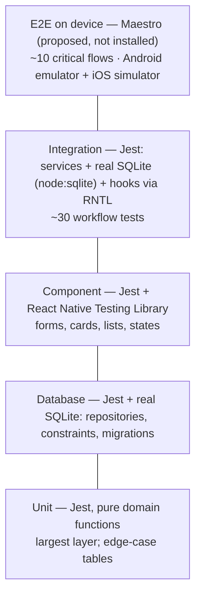

# D9 — Testing Strategy

**Phase:** 2 — DESIGN · **Status:** Provisional ([OD-01](open-decisions.md#od-01)) · **PRS:** NFR-007, NFR-008, all acceptance criteria · **AGENTS.md:** §12, §17
Related: [business-logic-design](business-logic-design.md) · [database-design §J.8](database-design.md#j8-migration-testing) · [recommendation-engine-design](recommendation-engine-design.md)

Detailed per-feature test plans will be written in `docs/tests/` during TASK/BUILD. This document defines levels, tooling, scope and the mandatory scenarios.

---

## 0. Test pyramid & tooling

| Level | Runner | Environment | Location |
|---|---|---|---|
| Unit | Jest (`jest-expo` preset, already configured) | Pure TS; no mocks needed | `src/domain/**/*.test.ts` |
| Database | Jest | **Real SQLite** through a `Db` adapter over Node's built-in `node:sqlite` (Node ≥ 22.13; verified working locally on 22.13.1 / SQLite 3.47.2). Alternative: `better-sqlite3` dev dependency ([OD-19](open-decisions.md#od-19)) | `src/data/**/*.test.ts` |
| Component | Jest + `@testing-library/react-native` (installed) | Services mocked at the feature boundary | `src/features/**/components/*.test.tsx`, `src/shared/ui/*.test.tsx` |
| Integration | Jest + RNTL + real SQLite adapter | Real services, repositories, domain; fake `Clock` | `tests/integration/*.test.tsx` |
| E2E | Maestro (recommended) | Dev/preview build on emulator/simulator/device | `e2e/*.yaml` (future) |

**Testability enablers (design requirements):**
- Repositories take a `Db` interface (`runAsync`, `getAllAsync`, `getFirstAsync`, `execAsync`, `withTransactionAsync`) rather than importing expo-sqlite directly. Production wires `expo-sqlite`; tests wire the `node:sqlite` adapter, which runs the same SQL.
- `Clock` is injected (`today()`, `nowIso()`), with a fixed clock in tests. No test depends on the real date.
- IDs come from an injectable generator (deterministic in tests).
- Snapshot tests are limited to small presentational components. Behavior is asserted with queries by role and label.

**Verification commands** (AGENTS.md §17): `npm test`, `npx tsc --noEmit`, `npx expo lint`, `npx expo-doctor`. Coverage gates for `src/domain/**`: ≥ 95% lines/branches. Repositories ≥ 85%.

---

## 1. Unit testing (domain)

Each formula in [business-logic §B](business-logic-design.md#b-financial-calculations) gets a table-driven test (`it.each`) that covers the listed edge cases plus the doc's worked example.

| Area | Mandatory cases |
|---|---|
| **Money parse** | `"1250.5"`→125050 · `"1,250.50"` · `"1,00,000"` · `"₹99,99,99,999.99"` (max) · `"99,99,99,999.991"` (too many decimals → reject, not round) · `"100000000"` (above max) · `"0"`, `"0.00"` (not positive) · `"-5"` · `""` · `"1.2.3"` · `"12,50"` (comma decimal → `AMOUNT_COMMA_DECIMAL`) · `"1,0,0"` · `" 12 "` (trim) · `"0.1"`+`"0.2"` sum = 30 exactly |
| **Money arithmetic & format** | currency mismatch throws · sum beyond `MAX_SAFE_INTEGER` throws `IntegrityError` · `formatMoney`: ₹0.00, ₹1,000.00, ₹1,00,000.00, ₹99,99,99,999.99, −₹1,250.50, `+` display · BigInt ratio rounding: 26.45→26.5, −26.45→−26.5, 0.05→0.1, 99.95→100.0 |
| **Totals & savings (FR-007)** | no transactions · zero income (rate unavailable) · zero expenses (100.0%) · negative savings (negative rate) · large values near the limits · label "Monthly savings" vs "Savings" |
| **Budgets (FR-008)** | 0/0 Healthy no % · 0 budget + spend Exceeded · 79.99% Healthy · exactly 80% Warning · exactly 100% Warning (not Exceeded) · 100.01% Exceeded · remaining/overspent never negative · version resolution: before first version, exactly at, between versions, after a removal (NULL), re-added later |
| **Goals (FR-009 – FR-011)** | completed (saved = target, saved > target) · target date today · in current month (p=1) · next month (p=2) · past (Expired) · rounding up (1,000,001/3) · progress display cap 99.9% · E unavailable (no complete month; lookback > 12 months) · E negative (Behind, no projection) · E = R_total (On Track) · E = 75% (At Risk) · E just below 75% (Behind) · paused/archived excluded · projection consistency invariant (property test over random inputs) · > 600 months |
| **Dates** | `toLocalDate` from local components · month ends for all months incl. Feb 2024 (29) / Feb 2025 (28) / Feb 2000 (29) / Feb 2100 (28) · add months across year boundaries · complete vs incomplete month on the last day and the first day · custom range start > end rejected · tests run under `TZ=America/Los_Angeles`, `TZ=Asia/Kolkata`, `TZ=Pacific/Kiritimati` (an npm script runs the domain suite in 3 zones) |
| **Validation (FR-003A)** | every row of [business-logic A.2](business-logic-design.md#a2-validation-rules-domaintransactionsschemats-zod), asserting the error code and that the message names the field · note 200 vs 201 code points (emoji counted as 1) · future date on create rejected, on unchanged-date edit accepted |
| **Recommendation rules** | per rule: trigger true/false at each threshold boundary (20.0% vs 19.9%; ₹500.00 vs ₹499.99) · history 2 vs 3 months · zero average · essential category never yields `suggestedAction` or `potentialSavings` · potential savings ≤ excess (property test) · merge/suppression (BUD-OVER absorbs ANOM for the same category) · ranking determinism (shuffled input → identical output) · banned-phrase scan of all rendered texts ("guarantee", "will save", "you should", "certain") · dashboard top-3 |
| **Reports** | category totals sum exactly to total expenses · ordering ties by sort_order |

---

## 2. Database testing

| Area | Scenarios |
|---|---|
| **CRUD** | insert/get/update (full replacement, clearing the note)/delete for transactions, budget versions, goals, profile · keyset pagination: no duplicates or gaps across pages with equal dates |
| **Relationships** | composite FK rejects an income transaction with an expense category · RESTRICT blocks deleting a referenced category/payment method · `goal_balance_events` CASCADE (if adopted) |
| **Constraints** | `amount_minor` 0, negative, 1e10, 12.5, `'1250'` rejected · invalid dates (`2026-02-30`, `2026-2-1`) rejected · expense without payment method / income with one rejected · duplicate budget (scope, month) rejected · zero budget accepted · note > 200 rejected · currency triggers: mismatch rejected, insert before onboarding rejected, currency change blocked when data exists and allowed when empty |
| **Aggregates** | totals by type/period, category totals, monthly savings series with empty months, budget resolution query; results equal to a brute-force JS reference over randomized fixtures |
| **Migrations** | fresh 0 → LATEST · each historical version → LATEST with fixtures and value-preservation assertions (row counts and checksums of money columns) · failure injection (throw in the middle) → `user_version` unchanged and data intact · `user_version > LATEST` → `DB_SCHEMA_NEWER`, no writes · legacy draft DB: empty → baseline; with data → `LEGACY_DATA_PRESENT`, nothing dropped · `foreign_key_check` empty · seed idempotency (running twice gives no duplicates) · **immutability**: hash of each shipped migration matches the recorded hash |
| **Data integrity** | all-or-nothing: a failure inside a multi-statement write leaves no partial rows (FR-026.3) · idempotent insert: the same `id` twice gives one row and the service returns success (FR-026.4) · Delete All Data leaves zero user rows, profile reset, seeds intact |
| **Recurring duplicate prevention** | MVP+: `UNIQUE(recurring_rule_id, occurrence_date)` makes catch-up idempotent across repeated runs and clock rollback. **Not applicable to the MVP schema**; the test is specified here for the FR-020 implementation. |

---

## 3. Component testing (RNTL)

| Component | Assertions |
|---|---|
| `TransactionForm` | expense vs income fields (payment method hidden for income) · inline errors name the field · Save disabled while submitting, double press → one `onSave` call · failed save shows the "not saved" banner and keeps values · type switch clears the category · default payment method preselected |
| `AmountInput` | live formatted preview · comma-decimal message |
| `SummaryCard` | savings rate "not available" text for zero income · negative savings shows a minus and the text label · "Savings" label for a custom range |
| `TransactionItem` / list | signed amounts, accessibility label content, date section headers, empty and no-results states |
| `BudgetProgressCard` | each status shows the text + icon (not color only) · zero budget hides % · "₹X over" text |
| `GoalProgressCard` / detail | each tracking state's badge and explanation · projection unavailable reason · 99.9% cap rendering |
| `RecommendationCard` / detail | priority text present · insight renders no action and no potential savings · potential savings shows "Up to … (estimate)" · "Why am I seeing this?" content |
| `ConfirmationDialog` | names the item; cancel is the default focus |
| `DatabaseErrorScreen` | shows no totals; Retry calls the gate |
| Accessibility | every pressable has `accessibilityRole` + label (a helper walks the rendered tree) |

---

## 4. Integration testing (workflows)

Run with the real services and repositories on an in-memory SQLite and a fixed clock (`today = 2026-11-06`), rendering the actual feature screens through RNTL.

| # | Workflow | Assertions |
|---|---|---|
| 1 | Add expense → dashboard update | Expenses, savings and rate change. The recent list shows the item. The budget for that category reflects it. |
| 2 | Add income → savings update | Savings and rate change. Rate goes from "not available" to a value when it was the first income. |
| 3 | Create budget → add expense → budget progress | Healthy → Warning at 80% → Exceeded above 100%. `BUD-WARN`/`BUD-OVER` appear in the recommendations. |
| 4 | Create savings goal → monthly target | Required monthly saving per FR-010 for target dates in this month, next month, and in 13 months. Tracking state appears only once a complete month exists. |
| 5 | Add 4 months of transactions → recommendations | `ANOM-DISC` for a discretionary spike, `ANOM-INFO` only for an essential spike, `GAP` when goals exceed E. Dashboard shows the top 3. |
| 6 | Edit/delete transaction → all dependents | Moving a transaction to a different month updates both months' totals, budget statuses, E, the goal state and the recommendations. Delete reverses everything. |
| 7 | Budget history | Change a budget in Nov → Oct still reports the old amount (FR-008.3). Remove it → Nov+ has no budget, Oct unchanged. |
| 8 | Currency lock | Change allowed on an empty DB; refused with an explanation after one transaction (FR-001.4). |
| 9 | Delete all data → onboarding | All screens are empty and onboarding is required again. |
| 10 | Startup failure | A simulated migration failure shows the database error screen, with no zero totals rendered (FR-027.2). |
| 11 | Export | The JSON validates against the export schema. Money values are integers. The counts match the DB. |

---

## 5. Cross-platform & device testing

| Requirement | Android (primary) | iOS (secondary) |
|---|---|---|
| Build type | Development build (`eas build --profile development` / `npx expo run:android`) and the preview APK | Development build on simulator (`npx expo run:ios`, requires macOS) or EAS internal distribution |
| OS versions | Minimum supported by SDK 57 + latest (two emulators) | Minimum supported by SDK 57 + latest |
| Reference device (NFR-001.2) | Proposed: a 2024-class mid-range Android (e.g. Samsung Galaxy A35 or similar, 6 GB RAM) ([OD-18](open-decisions.md#od-18)) | Not performance-gated |
| Manual checks per release | Airplane mode for every FR-024 function · process kill right after save (data persists) · device reboot (NFR-002) · time-zone change after entering a transaction near midnight · largest font size · TalkBack pass | VoiceOver pass · largest Dynamic Type · dark mode · iCloud backup exclusion check (once OD-15 is implemented) |
| Backup exclusion | Verify with `adb shell bmgr backupnow <package>` that the app is skipped | Inspect the file resource value via the local module's test hook |
| Performance (NFR-001) | Seed 50,000 transactions (a dev-only script) → measure dashboard first full render ≤ 1 s and save-to-visible ≤ 300 ms, 5 runs, median | — |

**E2E recommendation:** **Maestro**. It drives the dev or preview builds on both platforms through accessibility labels with YAML flows, needs no changes to app code, and works with Expo dev builds. Detox is the alternative (stronger synchronization, but heavier native setup). Not installed or configured in this phase.

Proposed critical E2E flows: onboarding · add expense · add income · edit + delete transaction · create budget and exceed it · create goal + update saved amount · view recommendations · reports by custom range · export · delete all data · restart persistence.
