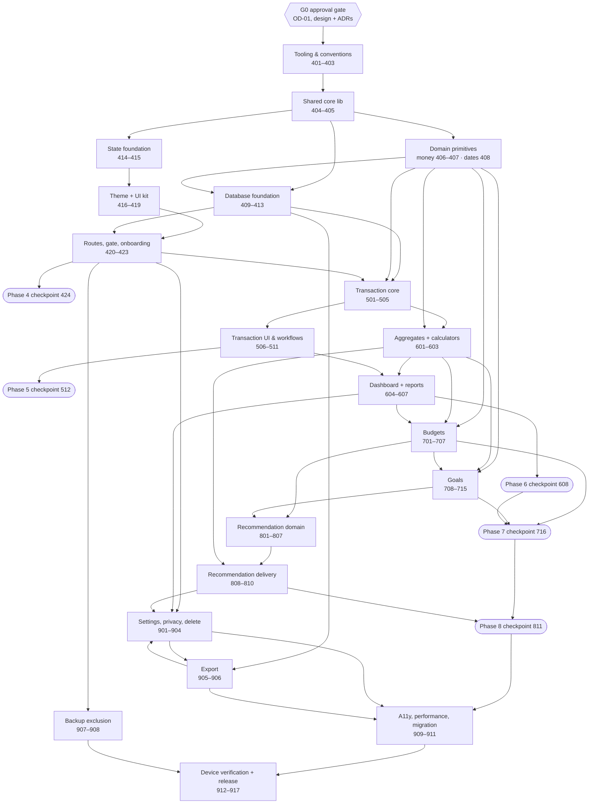
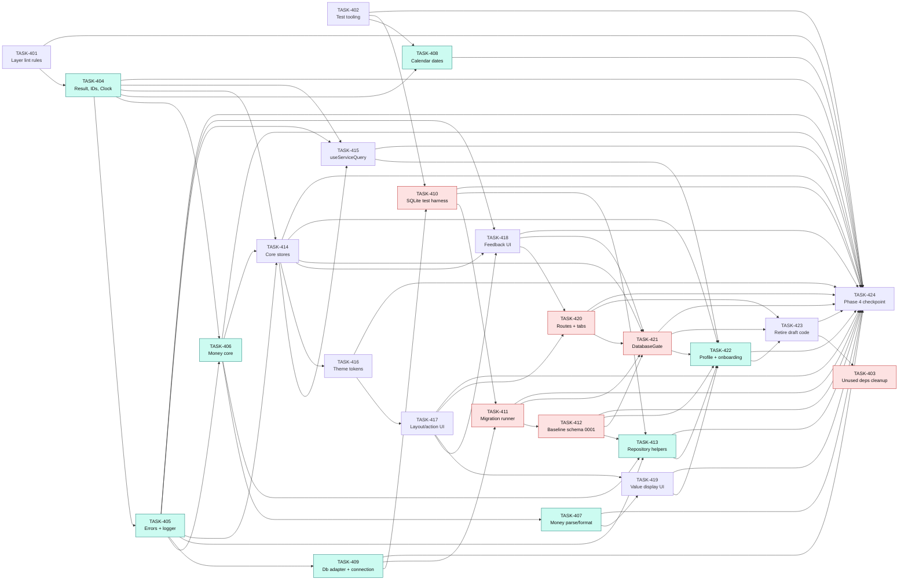
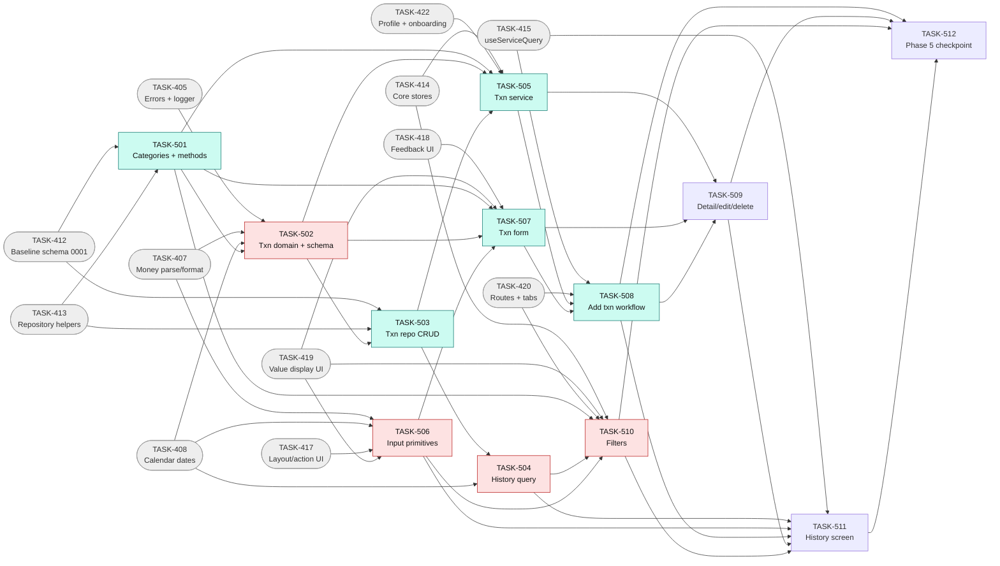
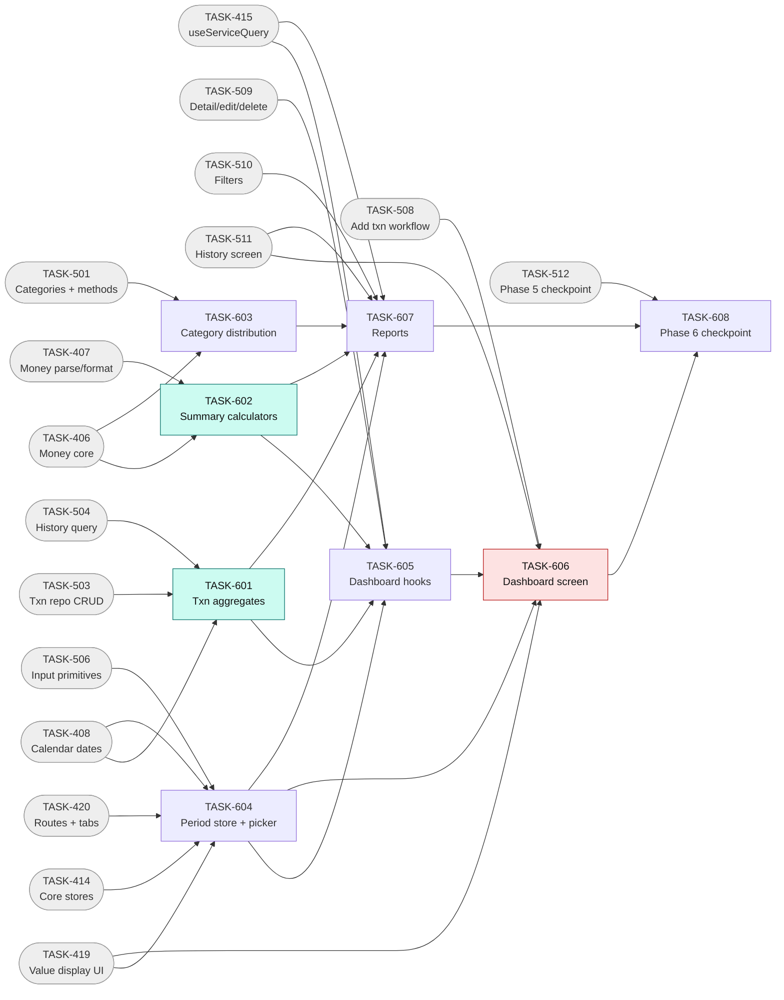
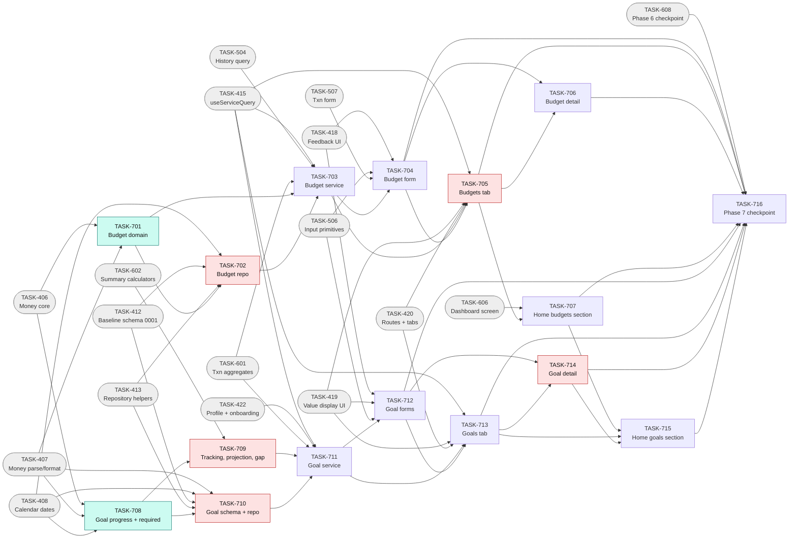
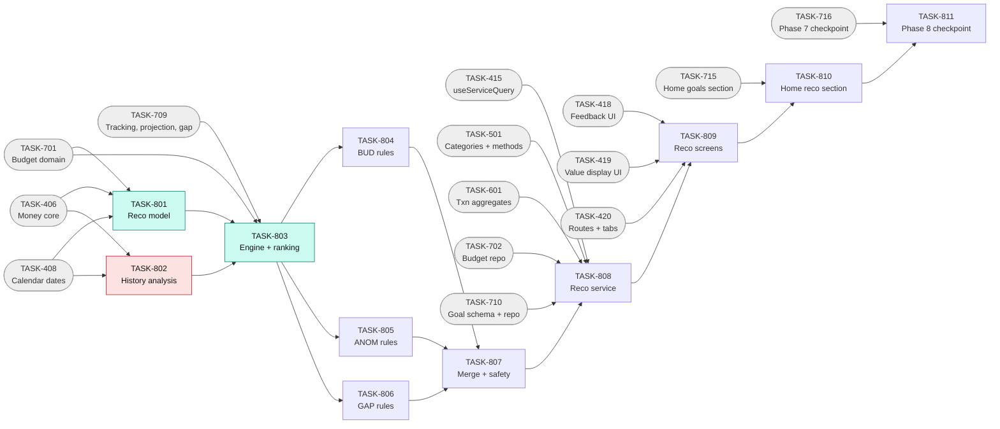
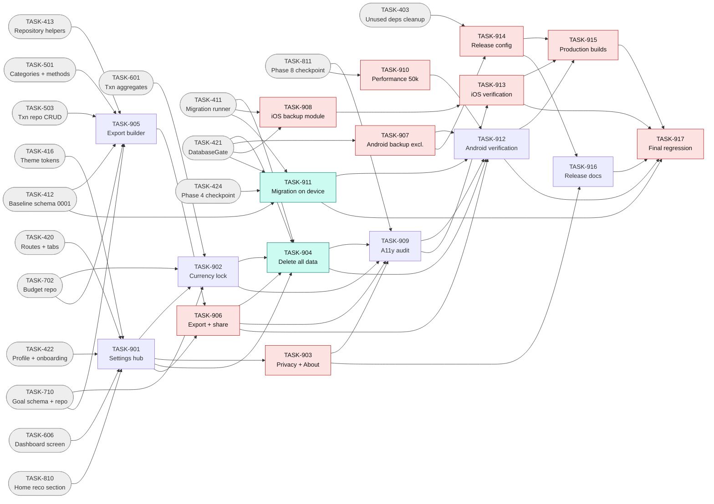

# Dependency Graph

> **PROVISIONAL** — every task additionally depends on gate **G0** (OD-01 + design/ADR approval), which is not drawn.

Source of truth: the `Dependencies` field of each task file. The graphs below were generated from those fields and checked mechanically: **88 tasks, 0 missing references, 0 cycles**, every `Blocks` list equals the reverse of the dependencies.

## 1. Feature-level overview



Notes on the overview: arrows summarise task-level edges. `SET ↔ EXP` is not a cycle at task level: TASK-905 → TASK-906 → TASK-904 (delete-all reuses the export temp-file cleanup) while TASK-901 → TASK-906.

## 2. Task-level graphs by phase

Legend: teal = CRITICAL, red = task-specific BLOCKED (OD/DG/external), grey rounded = prerequisite from another phase.
<!--MERMAID-->
### Phase 4 — Foundation



### Phase 5 — Transactions



### Phase 6 — Dashboard & Analytics



### Phase 7 — Budgets & Goals



### Phase 8 — Recommendations



### Phase 9 — Security & Release


<!--/MERMAID-->

## 3. Blocking vs optional dependencies

All edges above are **blocking** (the dependent task must not start before the prerequisite is DONE). Optional or soft relationships are deliberately **not** edges:

| From | To | Nature | Why it is not blocking |
|---|---|---|---|
| TASK-908 | TASK-903 | Optional | The privacy screen ships without the iOS sentence; it is added only once TASK-908 is DONE. |
| TASK-906 | TASK-911 | Optional | Export is the preferred before/after comparison artefact; a debug query is an acceptable substitute. |
| TASK-424 | TASK-501, TASK-502, TASK-506, TASK-602, TASK-701, TASK-708, TASK-801, TASK-802 | Soft (checkpoint) | These depend only on Phase 4 *domain/DB* tasks and may start before the Phase 4 checkpoint; see roadmap §3. |
| TASK-403 | TASK-424 | None | The LOW-priority cleanup does not gate the foundation checkpoint. |

## 4. Independent tasks (no task dependencies)

TASK-401 and TASK-402. Both can start immediately after G0, in parallel.

## 5. Critical path

The longest dependency chain (26 tasks) — any delay on it delays release:

```text
401 Layer lint → 404 Result/IDs/Clock → 405 Errors+logger → 406 Money core → 414 Core stores → 416 Theme
→ 417 Layout UI → 418 Feedback UI → 420 Routes+tabs → 421 DatabaseGate → 422 Onboarding → 505 Txn service
→ 508 Add txn → 509 Detail/edit/delete → 511 History screen → 606 Dashboard → 707 Home budgets
→ 715 Home goals → 810 Home recos → 901 Settings → 902 Currency lock → 904 Delete all data
→ 909 A11y audit → 912 Android verification → 915 Production builds → 917 Final regression
```

(901 → 906 → 904 is an equal-length alternative through the export flow.)

Near-critical chains (≤ 3 tasks shorter) that must be watched:

| Chain | Why it matters |
|---|---|
| 405 → 409 → 410 → 411 → 412 → 421 | Database foundation; blocked by OD-19, OD-14, OD-06, OD-09, OD-20, OD-11 — the **largest decision risk** on the path. |
| 708 → 709 → 803 → 804/805/806 → 807 → 808 → 809 → 810 | Goal tracking + recommendations; blocked by OD-03/04/05/22. |
| 422 → 711 → 713 → 714 → 715 | Goals UI feeding the dashboard hotspot. |

The UI chain (414 → 421) is on the critical path because the database gate (421) needs both the DB chain and the UI kit; starting UI primitives early (Wave 2) is the main lever.

## 6. Parallelizable groups

Tasks in the same group share no files (except listed append-only hotspots) and have no edges between them. Run them in parallel only after their prerequisites are DONE.

| Group | Tasks | Shared files / hotspots | Integration checkpoint |
|---|---|---|---|
| P1 | 401, 402 | `package.json` (402 only), `eslint.config.js` (401 only) | — |
| P2 | 406 → 407 · 408 · 409 | `src/domain/*/index.ts` per module (separate) | TASK-424 |
| P3 | 410 · 414 · 802 | none | — |
| P4 | 411 · 415 · 416 · 602 · 701 · 708 | none | — |
| P5 | 412 · 417 · 709 · 801 | `src/domain/recommendations/index.ts` (801 vs 802: append) | — |
| P6 | 413 · 418 · 419 · 803 | `src/shared/ui/index.ts` (418, 419: append) | — |
| P7 | 501 · 506 · 702 · 710 · 804 · 805 · 806 | `rules/index.ts` (804/805/806: one appended line each); `package.json` (506) | TASK-807 |
| P8 | 502 · 603 · 604 · 807 | `src/app/_layout.tsx` (604 modal registration) | — |
| P9 | 503 · 507 · 907 · 908 | `app.json` (907 only) | — |
| P10 | 504 · 505 · 905 | `transactionsRepo.ts` read-only for 505/905 | — |
| P11 | 508 · 510 · 601 | `src/app/_layout.tsx` (508, 510 modal registration: append) | TASK-512 |
| P12 | 509 · 703 · 711 · 808 · 911 · 914 | none (605 follows 509: same service file) | — |
| P13 | 704 · 712 · 809 · 511 | `src/app/_layout.tsx` (704, 712 modal registration: append) | — |
| P14 | 705 · 713 · 606 · 607 | `(tabs)/*.tsx` (each a different file) | TASK-608 |
| P15 | 902 · 903 · 906 · 910 | `SettingsScreen.tsx` rows (append) | — |

**Must remain sequential** (shared file edited non-trivially):

| Sequence | Shared file |
|---|---|
| 503 → 504 → 601 | `src/data/repositories/transactionsRepo.ts` |
| 505 → 509 → 605 | `src/features/transactions/services/transactionService.ts` (509 adds edit; 605 adds summary/recent) |
| 606 → 707 → 715 → 810 → 901 | `src/features/dashboard/components/DashboardScreen.tsx` |
| 420 → 421 → 422 → 423 | `src/app/_layout.tsx` (structural changes) |
| 901 → 902 → 904 | `src/features/settings/services/settingsService.ts` |
| 803 → 807 | `mergeAndSuppress.ts`, `engine.ts` |

**Append-only hotspots** (parallel edits allowed; resolve by keeping both additions): `src/app/_layout.tsx` modal registrations (508, 509, 510, 604, 704, 712, 714), `src/shared/ui/index.ts`, feature `index.ts` files, `SettingsScreen.tsx` rows (902, 903, 904, 906), `src/domain/recommendations/rules/index.ts` (804, 805, 806), `package.json` (506, 906 via `npx expo install`).

## 7. Tasks requiring approval before execution

| Approval | Tasks that cannot start without it | Downstream impact (transitively waiting) |
|---|---|---|
| **G0** — OD-01 PRS re-review; Phase 2 design + ADR-0001…0012 accepted | **All 88** | Everything |
| OD-02 tab set (ADR-0010) | 420 | 421 → whole app shell |
| OD-03, OD-04 goal tracking/projection | 709 | 711, 713 – 716, 803 – 811 |
| OD-05 lookback 12 months | 709 | as above |
| OD-06 priority values | 412, 710 | all DB-dependent work |
| OD-09 goal balance history | 412, 710 | all DB-dependent work |
| OD-10 budgets current month only (ADR-0006) | 702 | 703 – 707, 808 |
| OD-11 profile name (optional) | 412 (column CHECK) | — |
| OD-12 earliest transaction date | 502, 506 | 503 – 512 |
| OD-13 web unsupported | 403, 420 | — |
| OD-14 schema re-baseline (ADR-0005, ADR-0009) | 411, 412 | all DB-dependent work |
| OD-15 backup exclusion details (ADR-0011) | 907, 908, (903 sentence) | 912, 913 |
| OD-16 new dependencies | 506, 906 | 507 – 512, 604; 904 |
| OD-17 unused packages | 403 | 914 |
| OD-18 reference device | 910 | 912 |
| OD-19 test SQLite engine | 410 | 411 → all DB work |
| OD-20 "Food (eating out)" label | 412 | — |
| OD-21 goal-deposit guidance text | 714, 903 | 715, 716 |
| OD-22 partial first month | 802 | 803 – 811 |
| DG-02, DG-11 | 421 | 422 → everything after |
| DG-03 | 504, 510 | 511, 601, 703 |
| DG-04, DG-10 | 606 | 707, 715, 810, 901 |
| DG-05 | 705 | 706, 707 |
| DG-06 | 903 | 909, 916 |
| DG-07 | 914 | 915 |
| DG-09 (automated variant only) | 917 | — |
| DG-12 | 910 | 912 |
| External: macOS/Xcode, Apple account | 908, 913 | 915 (iOS part) |
| External: signing credentials, store accounts | 915 | 917 |
| External: iOS bundle identifier (PO input) | 914 | 915 |
